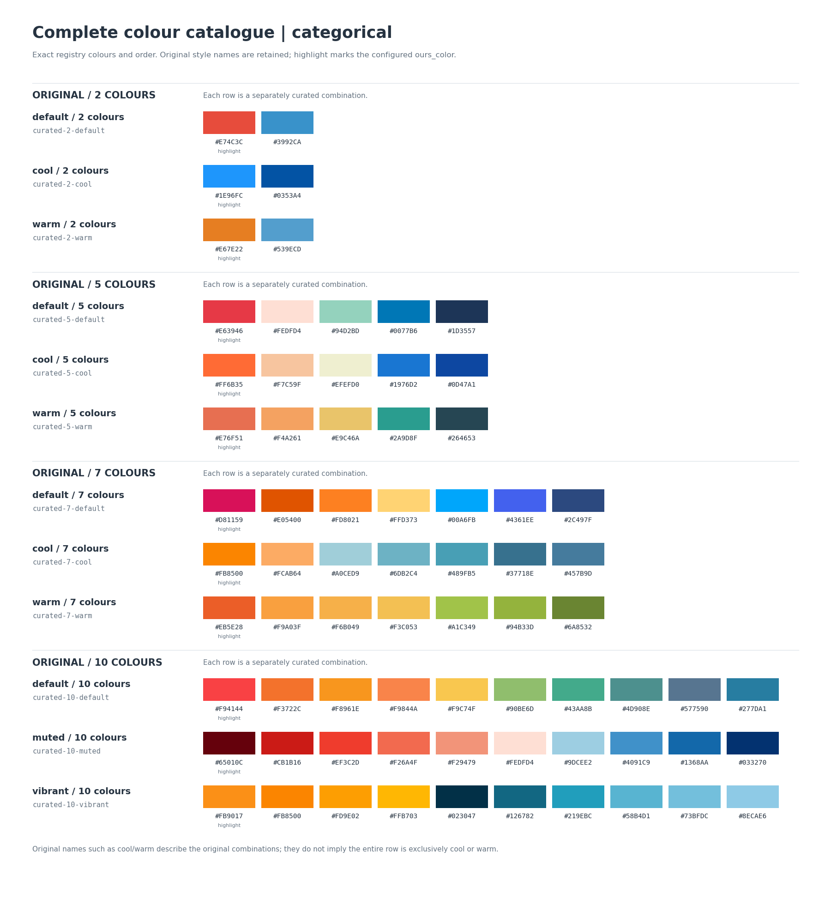
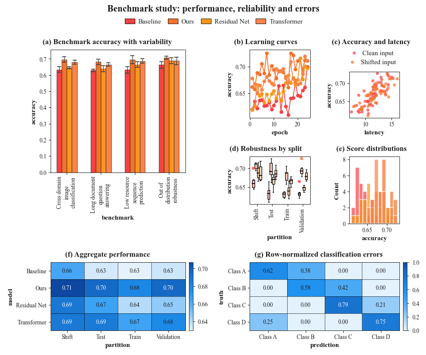

# PaperFig

指定 CSV、指标、图种和风格，生成排版与配色统一的论文 Figure。
底层使用 Matplotlib，统一处理字号、共享图例、坐标轴标签与留白，支持 SVG / PDF / PNG。

当前为 Alpha，接口仍在迭代。

## 安装

需要 Python 3.10+。在另一台设备上，先克隆已推送的仓库，再安装：

```bash
git clone <仓库地址> paperfig
cd paperfig
python -m pip install -e .
python demo/demo_simple_csv.py
```

已有本地副本时只需运行安装命令。建议使用独立虚拟环境；pip 会安装声明的 Python 依赖。
通过 `from data_visuals import plot` 调用，当前不提供 `paperfig` 命令行入口。
Times New Roman 需由操作系统提供；缺少时会回退其他衬线字体。跨设备精确复现版式需一致的字体与依赖版本。

## 快速开始

```python
from data_visuals import plot

fig = plot(
    "demo/data/benchmark.csv",  # 替换为你的 CSV
    x="dataset",
    group="model",
    plots=[
        {"kind": "bar", "metric": "accuracy"},
        {"kind": "line", "x": "epoch", "metric": "f1"},
        {"kind": "box", "metric": "latency"},
        {"kind": "histogram", "metric": "accuracy", "group": None},
    ],
    canvas={"width": 180},  # mm；省略 height 时测量后自动计算
    style="modern",
    palette="curated-10-default",
)
fig.render("figure.svg")
```

示例数据已随仓库提供；也可直接传入 DataFrame。CSV 需有表头，示例包含
`dataset, model, epoch, accuracy, f1, latency` 六列。

- `plots` 每项对应一个子图，列表决定数量和顺序；网格与子标题自动安排。
- `canvas={"width": 180, "height": 110}` 固定整图 180 × 110 mm；只给宽度则自动求高。
  省略时默认宽 180 mm、自动高度；可指定 `unit="in"`。
- `x/group` 是普通图的全局默认字段，子图可覆盖；`group=None` 关闭该子图分组。
- `metric` 选择指标：普通图对应 Y 值，直方图对应分布值，热力图对应颜色值。
- 可选 `cols=2` 限制每行最多两个子图；末行自动铺满宽度。

支持 `bar`、`line`、`scatter`、`box`、`histogram`、`heatmap`、`confusion` 七类图。
矩阵图需明确指定 `x/y`；柱图和重复 X 的折线默认按组取均值。
完整字段与统计口径见 [CSV 调用说明](docs/simple-api.md)。

## 风格与配色

`style` 控制字重、线条和网格，`palette` 独立控制整套颜色。
内置风格默认字体均为 **Times New Roman**；可通过 `FigureConfig.font_family` 显式覆盖。

| 参数 | 可选值 |
|---|---|
| `style` | `general`：较强标题（默认）；`modern`：较轻字重与网格 |
| `palette` | 12 套原始精选搭配，如 `curated-5-default`；默认 `curated-10-default` |

每套配色包含分类色、连续色阶和辅助线颜色；同一 Figure 中相同分组复用颜色与图例，
子图筛选后保持类别颜色。跨 CSV 固定类别颜色的方式见 [配色说明](docs/color-presets.md)。



[分类色卡 SVG](demo_outputs/colors/color_catalog_categorical.svg) · [全部连续色阶](demo_outputs/colors/color_catalog_sequential.png) · [精选整图示例](demo_outputs/colors/curated_5_default.png)

原始精选搭配保持色号与顺序，按 2 / 5 / 7 / 10 色选择，超出容量会提示换用更大色板。
可用名称和配套色阶见 [配色说明](docs/color-presets.md)。

## 导出与示例

```python
fig.render("figure.pdf")
fig.render("figure.png", dpi=300)
fig.show()  # Notebook 内联展示
```

DPI 改变 PNG 像素密度，不改变物理尺寸与版式。字体默认使用固定 pt：主标题 11、
子标题 9、轴标签 8、刻度 7、图例 8；单图和多图保持一致。按声明的物理尺寸放入论文时，
即得到这些字号。固定尺寸装不下时报告布局错误，自动高度模式则在固定宽度内求解。

```bash
python demo/demo_simple_csv.py         # CSV 简洁入口
python demo/demo_publication_mixed.py  # 七类图混排与布局压力示例
python demo/demo_color_catalog.py      # 全部原始色卡与精选整图示例
python demo/demo_canvas.py             # 90 mm 单图、固定组合图与自动高度
python demo/demo_rejection_rewrite.py --numbered  # 六格共享轴散点与迁移箭头
python demo/demo_rejection_rewrite_comparison.py  # 两个决策后果的参考→改写对照
python demo/demo_matched_training.py   # 单栏 near/far-OOD 差值与置信区间
python demo/demo_legend.py             # 共享四侧、局部四角及隐藏图例
```

输出按用途分目录，见 [示例输出索引](demo_outputs/README.md)。以下组合图由同一条数据、计算与排版管线生成：



[六格工作点迁移示例](demo_outputs/rejection_rewrite/working_points/rejection_rewrite_working_points.png) 同样使用完整管线，
包含共享轴、分组标记、箭头及可选编号；[用法](docs/matplotlib-backend.md#重复网格与散点装饰)。
[配对对照版](demo_outputs/rejection_rewrite/comparison/rejection_rewrite_comparison.png) 将误拒与漏放拆成两列，直接标注实际率及百分点变化。
[同误拒率训练差值](demo_outputs/matched_training/matched_training_single_column.png) 使用单栏 2×1 布局、预计算不对称区间和底部共享图例。

## 文档与开发

需要跨行跨列、宽高权重、双轴或自定义颜色时，可使用 `data_visuals.core.Figure`，
同样接受 `canvas`。显式旧参数 `aspect/base/cell_base` 保留旧版尺寸与比例字号行为，
不可与显式 `canvas` 混用。

- [CSV 调用说明](docs/simple-api.md)：字段映射、子图选项、CSV 编码。
- [配色预设](docs/color-presets.md)：色号、连续色阶与颜色覆盖。
- [排版与导出](docs/matplotlib-backend.md)：画布、字号、统计语义与验收边界。
- [图例配置](docs/matplotlib-backend.md#图例配置)：共享或局部位置、列数、字号、间距与显示文字。
- [开发指南](docs/dev-notes.md)：分层结构、布局诊断与新增图种。
- [Canvas 字段契约](CANVAS_CONTRACT.md)：已实现的物理尺寸字段、单图/多图规则与验收边界。

```bash
pip install -e ".[dev]"
python -m pytest -q
```
