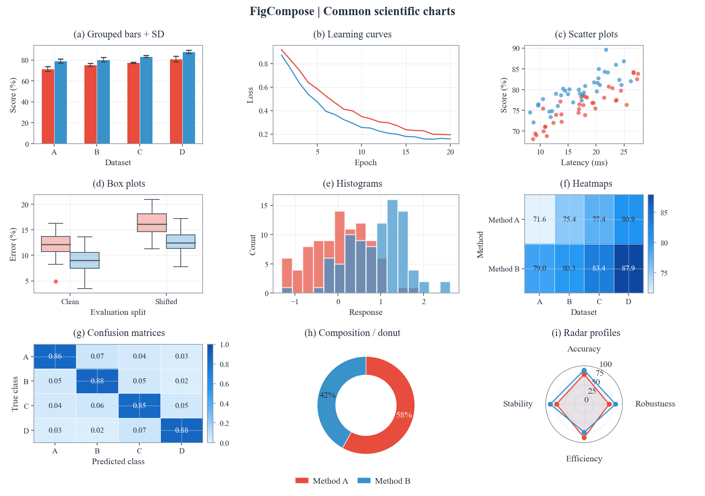
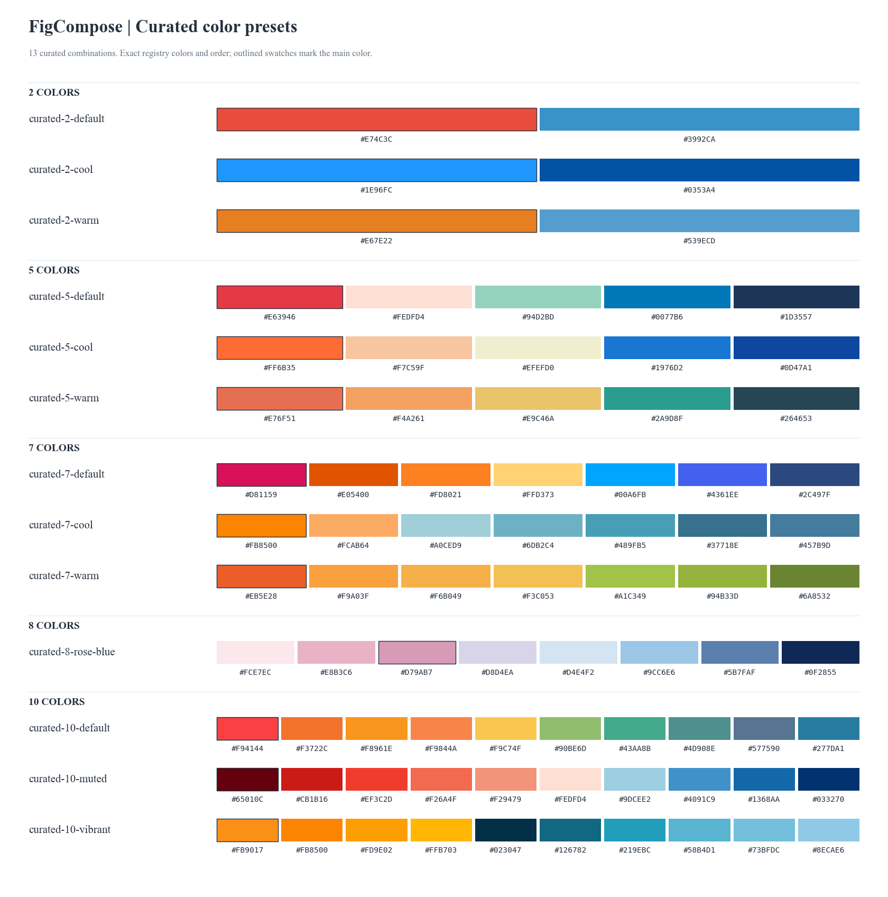
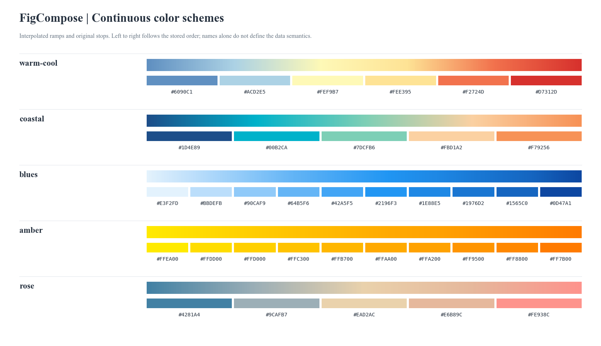

# FigCompose

Compose publication figures with Matplotlib.

指定 CSV、指标、子图类型和风格，生成排版与配色统一的论文 Figure。
FigCompose 以整张 Figure 为单位，统一管理物理尺寸、字号、分类颜色、共享图例与留白，
减少组合不同图种时反复调整样式与间距的工作。

- **声明式调用**：CSV 或 DataFrame 输入，选择列与图种，自动安排单图或多子图。
- **整图样式**：12 套精选配色，保留原始色号与顺序；按物理尺寸排版，导出 PDF / SVG / PNG。
- **原生扩展**：内置 10 类统计图，也可接入 Matplotlib 绘制函数，组合结构图、极坐标图或三维图。

当前为 Alpha，接口仍在迭代。项目名称为 **FigCompose**，当前 Python 包名和导入路径为 `data_visuals`。

## 图表示例



九个面板均通过 FigCompose 的声明式接口生成，共用字体、方法颜色与整图图例。
数据为固定随机种子的合成示例；另支持饼图及下表中的图种变体。
[查看矢量图](assets/readme/traditional_charts.svg) · [生成脚本](assets/readme/generate.py)

## 安装

需要 Python 3.10+。

```bash
git clone https://github.com/frederickc8896-Fabulous/FigCompose.git
cd FigCompose
python -m pip install -e .
```

默认字体为 **Times New Roman**，需由操作系统提供；缺少时回退其他衬线字体。
跨设备精确复现版式需要一致的字体与依赖版本。当前通过 Python API 调用。

## 快速开始

下面的示例可直接运行；使用自己的数据时，将 `data` 替换为带表头的 CSV 路径，
例如 `"results.csv"`，再指定对应列名即可。

```python
import pandas as pd
from data_visuals import plot

data = pd.DataFrame({
    "dataset": ["A", "A", "B", "B"],
    "model": ["Base", "Ours", "Base", "Ours"],
    "accuracy": [0.78, 0.86, 0.81, 0.89],
    "latency": [14.0, 10.0, 15.0, 11.0],
})

fig = plot(
    data,  # 或 "results.csv"
    x="dataset", group="model",
    plots=[
        {"kind": "bar", "metric": "accuracy", "title": "(a) Accuracy",
         "chart_opts": {"ylabel": "Accuracy (%)", "yformat": ".0%"}},
        {"kind": "line", "metric": "latency", "title": "(b) Latency",
         "chart_opts": {"ylabel": "Latency (ms)", "yformat": ".0f"}},
    ],
    canvas={"width": 180},
    style="modern", palette="curated-5-warm",
    title="Model comparison",
    legend={"scope": "shared", "ncols": 2},
)
fig.render("figure.pdf")
fig.render("figure.png", dpi=300)
```

- `plots` 每项对应一个子图；子图数量由列表长度决定，`cols=2` 可限制每行最多两个子图。
- `x/group` 为全局默认列，子图可以覆盖；`group=None` 关闭该子图分组。
- `canvas` 控制整张 Figure 的物理尺寸，默认宽 180 mm；只给宽度时测量后自动求高，也可指定 `unit="in"`。
  `{"width": 180, "height": 110}` 固定整图尺寸，装不下时报告布局错误。
- `style` 支持 `general`、`modern`；`palette` 独立选择配色。
  `from data_visuals import list_color_presets` 可查询全部 12 套精选配色。
- 导出支持 `.pdf`、`.svg`、`.png`。DPI 只改变 PNG 像素密度，不改变物理尺寸与版式。

## 整篇论文复用一份配置

`FigureConfig` 可同时交给简洁入口 `plot(..., config=paper)` 和高级入口 `Figure(config=paper)`。
字体、色系、画布、图例、字段显示和系列身份只声明一次；单张图仍能覆盖默认值。

```python
import pandas as pd
from data_visuals import FigureConfig, plot

paper = FigureConfig(
    canvas={"width": 180},  # 默认 mm；高度按内容求解
    theme="modern", palette="curated-5-warm",
    font_family="Times New Roman",
    legend={"scope": "shared", "ncols": 3},
    fields={
        "epoch": {"label": "Training epoch", "format": ".0f"},
        "f1": {"label": "F1 score", "unit": "%", "format": ".0%"},
    },
    series={"model": [
        {"id": "base", "label": "Baseline", "marker": "o", "linestyle": "--"},
        {"id": "large", "label": "Large model", "marker": "s", "linestyle": "-."},
        {"id": "ours", "label": "Our method", "marker": "D", "linestyle": "-"},
    ]},
)

data = pd.DataFrame({
    "epoch": [1, 2, 1, 2, 1, 2],
    "model": ["base", "base", "large", "large", "ours", "ours"],
    "f1": [0.70, 0.76, 0.78, 0.83, 0.82, 0.89],
})
for name, frame in [("all", data), ("subset", data[data.model != "base"])]:
    plot(frame, config=paper, x="epoch", group="model",
         plots=[{"kind": "line", "metric": "f1"}],
         title="Training comparison").render(f"{name}.pdf")

paper.save("paper.yaml")  # 也支持 .yml / .json
restored = FigureConfig.load("paper.yaml")
```

- **字段元信息**：`fields` 使用原始列名索引。`label` 用于轴标题和自动子标题，`unit` 附在轴标题后，`format` 控制数字显示。CSV 列名与数值保持原样。
  `".0%"` 把 0–1 显示为百分比；`"{x:.0f}%"` 给已经是 0–100 的值加百分号。单位本身不触发缩放。
  矩阵的数值格式也用于色条与注释；局部 `fmt` 只覆盖矩阵注释。归一化混淆矩阵和百分比堆叠不会继承原始数值单位。
- **系列身份**：`series` 以 `group` 列名索引，按列表顺序分配原色系的颜色；可选 `color` 固定色号。
  曲线、散点和雷达复用 `marker`，曲线与雷达复用 `linestyle`。不同 CSV 缺少某个系列时，保留其颜色位置，图例只显示实际出现的系列。
  请登记该列的完整系列集合；未登记的 ID 会报错。原始 ID 与显示名分别保存，不根据 `ours` 等名称自动赋予样式。
- **覆盖优先级**：默认主题 → 论文配置 → 单图调用 → 子图 `chart_opts`；既有 `category_colors` 覆盖登记的颜色，子图 `series_styles` 可继续覆盖。
  图例仍可自由调整位置、列数、顺序与文字；`legend.order/labels` 可以使用原始系列 ID。
- **配置文件**：JSON / YAML 都可校验后加载，未知字段会报错。数值型字典键请用 YAML 保存；JSON 会拒绝可能改变键类型的配置。

单份配置可以描述比当前 CSV 更多的字段和系列。当前图没有使用的列不会参与计算；同一坐标轴上的多个指标若声明了冲突的单位或格式，需要明确覆盖或分轴。

## 图种与统计口径

| 图种 | `kind` | 主要字段 | 默认行为与变体 |
|---|---|---|---|
| 柱状图 | `bar` | `x`, `metric`, 可选 `group/error` | 按组取均值；支持误差线、水平柱、堆叠与百分比堆叠 |
| 折线图 | `line` | `x`, `metric`, 可选 `group` | 重复 X 观测取均值；支持点标记、阶梯线与面积填充 |
| 散点图 | `scatter` | `x`, `metric`, 可选 `group/size` | 保留观测；支持气泡大小与预计算区间 |
| 箱线图 | `box` | `x`, `metric`, 可选 `group` | 按组展示分布；支持水平箱线与异常值点 |
| 直方图 | `histogram` | `metric`, 可选 `group` | 支持分箱、密度曲线与累积分布 |
| 热力图 | `heatmap` | `x`, `y`, `metric` | 按两维分组取均值，支持数值标注 |
| 混淆矩阵 | `confusion` | `x`, `y`, 可选 `metric` | 计数或汇总给定数量，支持行归一化 |
| 饼图 / 环形图 | `pie` / `donut` | `group`, 可选 `metric` | 按类别求和；省略份额列时计数 |
| 雷达图 | `radar` | `x`, `metric`, 可选 `group` | 重复观测取均值，至少三个完整指标轴 |

`metric` 对普通图和雷达图表示 Y 值，对直方图表示分布值，对矩阵图和饼图表示数量或颜色值。
饼图要求份额有限、非负且总和为正。雷达图使用长表，不自动归一化或补齐缺失指标。

全图 `legend` 可设置共享或局部图例、位置、列数、字号、边框、顺序和显示名；
子图通过 `chart_opts={"legend": {...}}` 覆盖，`legend=False` 隐藏图例。
共享图例默认居中放在主标题下方、子图上方；显式设置 `position="bottom"` 等可调整位置。
默认物理字号：主标题 11、子标题 9、轴标签 8、刻度 7、图例 8 pt，单图与多图保持一致。

## 坐标轴与紧凑排版

柱状、折线、散点、箱线和直方图共用 `chart_opts` 中的轴配置，显示名称可以独立于 CSV 列名：

| 选项 | 示例与含义 |
|---|---|
| `xlabel` / `ylabel` | `"Accuracy (%)"`；空字符串隐藏轴标题 |
| `xlim` / `ylim` | `[0, 100]`；固定范围，可使用倒序范围 |
| `xticks` / `yticks` | `[0, 25, 50, 75, 100]`；固定刻度 |
| `xticklabels` / `yticklabels` | 与对应刻度等长的显示文字 |
| `xformat` / `yformat` | `".2f"` 保留两位小数；`".0%"` 将 0–1 显示为百分比；`"{x:.0f}%"` 为 0–100 数值添加百分号 |
| `xscale` / `yscale` | `"linear"`、`"log"`、`"symlog"`；分类轴保留线性尺度 |

热力图和混淆矩阵支持轴标题及刻度显示覆盖，保持分类矩阵范围；雷达图沿用径向 `ylim`。
不适用或冲突的轴配置明确报错。水平柱图、水平箱线图的轴配置指屏幕上的 X/Y 轴。

物理画布下，同类图保持绘图区对齐，混排时矩阵色条和圆形图外标签使用各自的留白；
`FigureConfig.facets` 仍为比较图保留严格等大绘图区。
布局实测后尝试回收多余留白，回收失败时恢复保守布局；自动高度综合考虑真实绘图区宽高。
样式渲染隔离外部 Matplotlib 视觉设置，原生回调仍可显式调整自己的图元。

## 出图检查与布局快照

`fig.check()` 实测最终文字、字体和绘图区，不调整数据、字号、坐标范围或画布。
可生成独立检查图，定位文字越界、刻度重叠、字号过小等问题：

```python
import pandas as pd
from data_visuals import plot

fig = plot(
    pd.DataFrame({"epoch": [1, 2, 3], "score": [0.70, 0.81, 0.87]}),
    x="epoch", plots=[{"kind": "line", "metric": "score"}],
    canvas={"width": 90}, title="Training progress",
)
report = fig.check(debug="layout_check.png")
print(report.summary())
report.raise_for_errors()  # 可选；include_warnings=True 也要求消除警告
report.save("layout_baseline.json")  # 首次建立基线；后续检查保留此文件

comparison = fig.check().compare("layout_baseline.json", tolerance=0.5)
print(comparison.summary())
```

- `min_fontsize=7`、`min_tick_gap=1`、`tolerance=1` 均以 **pt** 衡量，可在 `check()` 中覆盖。
  `report.ok` 表示没有错误；小字号、刻度与装饰重叠等警告仍列在报告中。
- 报告含实际画布、各子图绘图区、文字边界、实际字体和颜色；调试图用蓝色虚线标记单元、绿色标记绘图区，橙色/红色框定位问题。支持 PNG / SVG / PDF，正式导出不带叠层。
- `.compare()` 按已记录的物理位置、文字、字体和实际图元样式检查布局变化，默认允许 **0.5 pt 几何误差**；字号与颜色严格比较。DPI 不参与比较。这是布局快照，不是像素截图比较。
- 已用 `mpl_fig = fig.render()` 做原生 Matplotlib 调整时，可用 `from data_visuals import check_figure`，再调用 `check_figure(mpl_fig)` 检查当前结果；该函数不关闭调用者的 Figure。

绘图区面积占比是矩形分配指标，不代表空白率或审美评分。检查不判断统计结论、数据图元重叠，
也不保证结构图内部节点、连线或投影三维文字没有碰撞；具体覆盖限制写入报告。
固定画布本身无法容纳内容时，仍抛出带尺寸提示的 `LayoutError`。

## 自定义 Matplotlib 面板

高级入口 `data_visuals.core.Figure` 支持跨格布局、宽高权重与原生绘制函数。
纯自定义 Figure 不需要 CSV 或占位 DataFrame：

```python
from data_visuals.core import Figure, PanelResult

def draw_module(ax, ctx):
    text = ax.text(
        0.5, 0.5, "Encoder", ha="center", va="center",
        bbox={"boxstyle": "round,pad=0.6", "facecolor": ctx.background},
        **ctx.text_kwargs(),
    )
    return PanelResult(artists=[text])

paper = Figure(rows=1, cols=1, canvas={"width": 90}, legend=False)
paper[0, 0].custom(draw_module, min_size=(120, 70), preferred_aspect=2)
paper.render("model.svg")
```

`.custom()` 接受 `projection="polar"`、`"3d"` 或已注册的 Matplotlib 投影名，
`axes_options` 传入原生轴构造参数。需要显示坐标轴时指定 `axes="on"`。
`min_size` 使用 pt；`box_aspect` 表示面板绘图区的宽/高。

通过 `ctx.text_kwargs()`、`ctx.color()` 使用统一样式；通过 `PanelResult` 返回测量对象、
图例句柄或 `layout(ax, ctx)` 尺寸更新函数。框架管理整图，回调负责内部节点与连线。
自动尺寸试绘和正式导出会重新执行回调，回调应可重复构建且不产生外部副作用。
自定义回调属于运行时对象，含回调的 Spec 不能序列化为 JSON。

## 项目范围

FigCompose 负责可复用的样式与整图排版。数据列、统计口径、坐标范围与图的科学表达由调用者确定；
自定义结构图的内部节点与连线也由绘制函数安排。

仓库包含绘图库源码、主题、安装配置、本 README 及其展示素材；本地演示、输出、测试、详细文档和实验数据均已忽略。
上面的示例自带数据，克隆并安装后即可运行。重新生成 README 图片：`python assets/readme/generate.py`。

## 配色色卡

### 分类色与整图预设

以下 **12 套**预设直接引用 `data_visuals/utils/colors.py` 中的原始搭配，色号与顺序保持不变。
在 `plot()` 中传入完整名称，例如 `palette="curated-5-warm"`；`style` 独立控制字体与排版。
名称中的 2 / 5 / 7 / 10 表示类别容量：类别较少时取前几色，超出容量时需选择更大的预设。
`cool`、`warm` 等名称沿用原配置，实际冷暖分布请以色卡为准。



[查看矢量色卡](assets/readme/color_presets.svg)。可通过 `list_color_presets()` 查询所有名称：

```python
from data_visuals import list_color_presets

print(list_color_presets())
```

### 连续色阶

热力图和混淆矩阵默认使用整图预设配套的连续色阶，也可在子图中显式设置，
例如 `chart_opts={"color_scheme": "blues"}`。
下方展示全部 **5 套**原始色阶，渐变与原始色阶节点对应。



[查看矢量色卡](assets/readme/color_schemes.svg)
