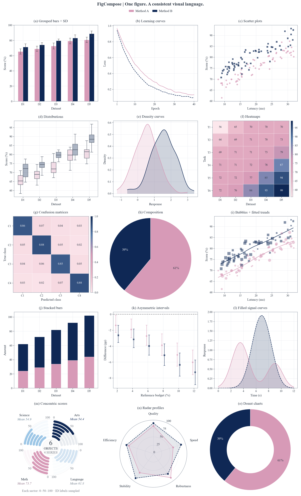
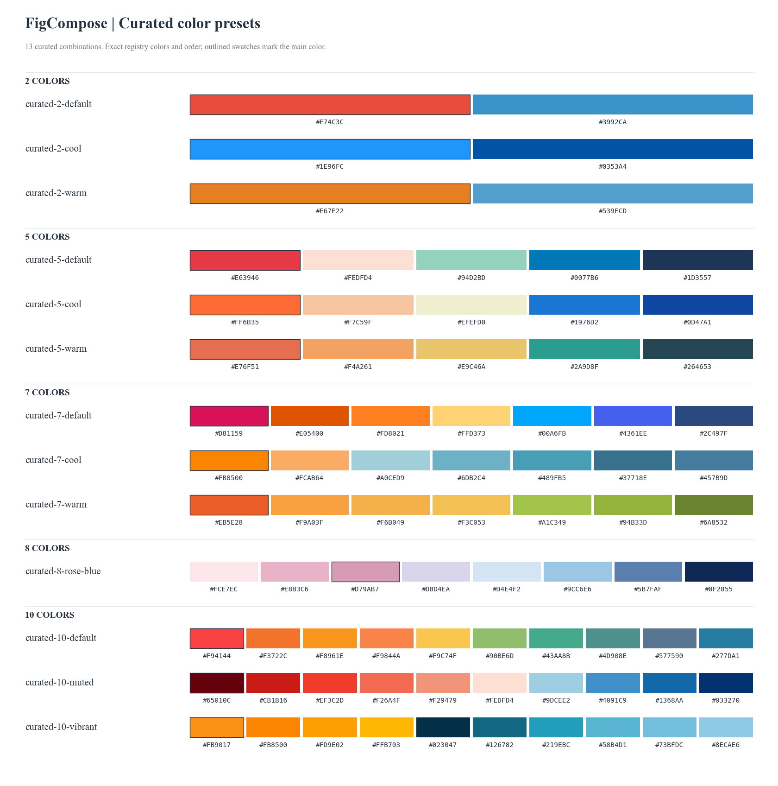
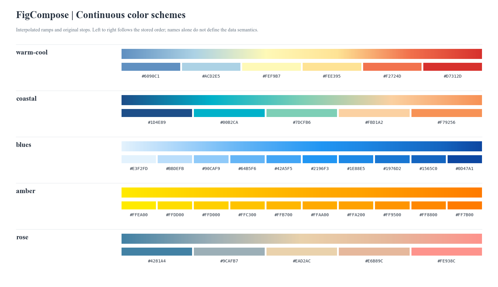

# FigCompose

<p>
  
</p>

**English** | [简体中文](https://github.com/frederickc8896-Fabulous/FigCompose/blob/main/README.zh-CN.md)

[](https://pypi.org/project/FigCompose/)
[](https://pypi.org/project/FigCompose/)
[](https://github.com/frederickc8896-Fabulous/FigCompose/blob/main/LICENSE)

**Choose your data and charts. Let FigCompose handle the figure layout.**



**11 built-in chart types, 15 panels, one consistent configuration.** Generated directly with FigCompose 0.1.2 using synthetic data.
[View SVG](https://github.com/frederickc8896-Fabulous/FigCompose/blob/main/assets/readme/hero_gallery.svg) · [Reproduce this figure](https://github.com/frederickc8896-Fabulous/FigCompose/blob/main/assets/readme/hero.py)

Start with a CSV or DataFrame, choose metrics, chart types and a style, and keep fonts, colors, legends and spacing consistent throughout the figure.
When results change, reuse the same visual settings with less manual adjustment.

- **Less tweaking, less repeated work**: arrange common charts and decoration spacing automatically, reducing repeated font, legend and margin adjustments.
- **Built-in curated palettes**: 13 categorical palettes and 5 continuous scales, with warm, cool and mixed color combinations.
- **Consistent colors across your paper**: register your series to retain each model's colors, markers and line styles across CSVs. When a model is absent, the others keep their identities.
- **Different charts, one layout**: combine bars, lines, scatter plots, heatmaps and more in one figure with consistent fonts, colors and shared legends.
- **Export at publication dimensions**: set the width in mm or inches and let height adapt to the content. Font sizes use pt; export to PDF, SVG or PNG.
- **Keep Matplotlib's flexibility**: custom diagrams, polar plots and 3D plots can join the same layout framework. Figure checks help find overflow and tick collisions.

[Quick start](#quick-start) · [Chart types](#supported-charts) · [Paper configuration](#one-configuration-for-an-entire-paper) · [Color catalog](#color-catalog) · [Detailed usage](https://github.com/frederickc8896-Fabulous/FigCompose/blob/main/REFERENCE.md)

## Installation

Requires Python 3.10+:

```bash
python -m pip install "FigCompose>=0.3.1"
```

The package is named **FigCompose**; Python imports use `data_visuals`.
**FigCompose 0.3.1** includes **22 native chart types**, all 13 curated palettes and the `general`, `modern` and `showcase` styles. Upgrade older installations with `python -m pip install --upgrade "FigCompose>=0.3.1"`.
The hero image above demonstrates 11 chart types; the full set also includes distribution, paired-data, chord, 3D, participant-track, clustered-heatmap and alluvial charts.
The default font is **Times New Roman**, supplied by your system. Starting in **0.3.1**, FigCompose bundles **Tinos** in regular, bold, italic and bold italic, and loads it automatically when Times New Roman is unavailable. Available fonts explicitly listed in `font_family` take priority; math expressions still use STIX. Tinos is an independent Times-compatible font; Chinese text needs a font with Chinese glyphs.

<details>
<summary>Install the latest source or update an existing installation</summary>

Install the source to use the latest chart types and palettes:

```bash
git clone https://github.com/frederickc8896-Fabulous/FigCompose.git
cd FigCompose
python -m pip install -e .
```

Update an existing source installation from the repository directory:

```bash
git pull --ff-only
python -m pip install -e .
```

Update a PyPI installation:

```bash
python -m pip install --upgrade "FigCompose>=0.3.1"
```

</details>

## Quick start

This example runs as written. For your own data, replace `data` with a CSV path such as `"results.csv"`, with a header row, then select the corresponding column names.

```python
import pandas as pd
from data_visuals import plot

data = pd.DataFrame({
    "dataset": ["A", "A", "B", "B"],
    "model": ["Base", "Ours", "Base", "Ours"],
    "accuracy": [0.78, 0.86, 0.81, 0.89],
    "latency": [14.0, 10.0, 15.0, 11.0],
})

fig = plot(
    data,  # Or "results.csv"
    x="dataset", group="model",
    plots=[
        {"kind": "bar", "metric": "accuracy", "title": "(a) Accuracy",
         "chart_opts": {"ylabel": "Accuracy (%)", "yformat": ".0%"}},
        {"kind": "line", "metric": "latency", "title": "(b) Latency",
         "chart_opts": {"ylabel": "Latency (ms)", "yformat": ".0f"}},
    ],
    canvas={"width": 180},
    style="modern", palette="curated-5-warm",
    title="Model comparison",
    legend={"scope": "shared", "ncols": 2},
)
fig.render("figure.pdf")
fig.render("figure.png", dpi=300)
```

For everyday use, focus on these settings:

| Setting | What to choose |
|---|---|
| `data` | A CSV path or DataFrame |
| `x` / `group` | X-axis and grouping columns, such as dataset and model |
| `plots` | One entry per panel, selecting a chart `kind` and `metric` |
| `canvas` | The whole figure's width, in mm by default; omit height to solve it automatically |
| `style` / `palette` | A visual style and palette, such as `modern` / `curated-5-warm` |

Use `cols=2` to limit panels per row. Shared legends default to below the main title and above the panels; position, columns and font size remain adjustable.
For proportions, `.0%` displays 0–1 as percentages; use `{x:.0f}%` for values already on a 0–100 scale.
A fixed width and height will not silently shrink fonts; if the content cannot fit, you are prompted to adjust the dimensions.
`style="showcase"` selects larger presentation typography through the same style API. Explicit `FigureConfig.font_sizes` overrides win; palette hex values and category order stay unchanged.

### Ask AI to write the call

Give your AI assistant the column names, data units and what you want to show, and ask it to use FigCompose's concise API. For example:

> Use FigCompose (`from data_visuals import plot`) to read `results.csv`. Its columns are `dataset`, `model`, `accuracy` (0–1) and `latency` (ms). Group by model and draw an accuracy bar chart and a latency line chart, with two panels per row. Set the figure width to 180 mm with automatic height, use the `modern` style and `curated-5-warm` palette, place the shared legend below the title, and export PDF and 300 dpi PNG.

For more complex settings, give your assistant the [API reference](https://github.com/frederickc8896-Fabulous/FigCompose/blob/main/REFERENCE.md) as well.

## Ready-to-run examples

Download or clone the complete `examples/` directory, keeping its shared `_export.py`,
install `FigCompose>=0.3.1`, and run a complete example. Each example folder includes its actual CSV, saved style, code and expected image.

| Start here | What you can reproduce |
|---|---|
| [Mixed figure](https://github.com/frederickc8896-Fabulous/FigCompose/tree/main/examples/mixed_figure) | Four charts with stable method identities across two CSVs |
| [Differences and intervals](https://github.com/frederickc8896-Fabulous/FigCompose/tree/main/examples/intervals) | Six native statistical views, with explicit paired estimates and supplied asymmetric bounds |
| [Concentric scores](https://github.com/frederickc8896-Fabulous/FigCompose/tree/main/examples/circular_scores) | The native circular-bar chart, with 40 scores and independent scales |

Run, for example, `python examples/circular_scores/generate.py --out output/circular`.
[Browse all eight examples](https://github.com/frederickc8896-Fabulous/FigCompose/blob/main/examples/README.md), including native 2D/3D comparisons, chords, participant tracks, circular clustering and alluvial flows. All eight use native chart declarations available in FigCompose 0.3.0.

## Supported charts

FigCompose 0.3.1 supports the following 22 native `kind` values.

| Chart | `kind` | Common uses |
|---|---|---|
| Bar | `bar` | Grouped, horizontal, stacked and percentage-stacked bars; error bars |
| Line | `line` | Trends, markers, step lines and area fill |
| Scatter | `scatter` | Points, bubbles and precomputed differences with intervals |
| Box | `box` | Grouped distributions, horizontal boxes and outliers |
| Histogram | `histogram` | Distributions, density curves and cumulative distributions |
| Heatmap | `heatmap` | Metric matrices and value annotations |
| Confusion matrix | `confusion` | Counts, supplied quantities and row normalization |
| Pie / donut | `pie` / `donut` | Category shares |
| Radar | `radar` | Comparing profiles across metrics |
| Concentric circular bars | `circular_bar` | Independent metric scores for multiple objects and group means |
| Raincloud / ridgeline | `raincloud` / `ridgeline` | Raw observations, distribution shapes and descriptive summaries |
| Paired / estimation | `paired` / `estimation` | Matched observations; supplied or explicitly requested uncertainty |
| Weighted chords | `chord` | Undirected pair weights on one endpoint-width scale |
| 3D scatter | `scatter3d` | Measured X/Y/Z points and explicitly selected projection planes |
| 3D waterfall | `waterfall3d` | Ordered series in depth, with a declared baseline |
| 3D bars | `bar3d` | Complete category grids and explicit component stacks |
| Participant tracks | `participant_tracks` | Aligned categorical and explicitly scaled numeric cohort tracks |
| Circular clustered heatmap | `clustered_heatmap` | Raw trait matrix, actual Ward distances and cluster annotations |
| Alluvial flows | `alluvial` | Complete weighted paths with conserved marginals across 2–8 stages |

For repeated observations, bars, lines, radar plots and heatmaps default to means within their respective groups. Pie and donut charts sum values by category, or count rows when the value column is omitted; scatter plots retain observations.
Circular bars use independent score scales rather than shares of a total. Repeated object/metric pairs require an explicit aggregation choice.
Distribution shape is not a confidence interval. Paired charts require explicit pair identities and two-level order; estimation requires supplied bounds or an explicit `ci_method="paired_t"` and `confidence`. Units and percentage scales are never guessed.
See the [API reference](https://github.com/frederickc8896-Fabulous/FigCompose/blob/main/REFERENCE.md) for statistical definitions, data formats and custom Matplotlib panel examples.

## One configuration for an entire paper

Save fonts, palettes, metric display names and model identities once, then use the same `paper.yaml` for subsequent figures.
Continuing with `data` from the quick start, the complete data and a subset without the baseline retain the same model colors and markers:

```python
from data_visuals import FigureConfig, plot

paper = FigureConfig(
    canvas={"width": 180}, theme="modern", palette="curated-5-warm",
    font_family="Times New Roman",
    legend={"scope": "shared", "ncols": 2},
    fields={"accuracy": {"label": "Accuracy", "unit": "%", "format": ".0%"}},
    series={"model": [
        {"id": "Base", "label": "Baseline", "marker": "o", "linestyle": "--"},
        {"id": "Ours", "label": "Our method", "marker": "D", "linestyle": "-"},
    ]},
)
paper.save("paper.yaml")

for name, frame in [("all", data), ("subset", data[data.model != "Base"])]:
    plot(frame, config=paper, x="dataset", group="model",
         plots=[{"kind": "line", "metric": "accuracy"}],
         title="Model comparison").render(f"{name}.pdf")

# In a later script: paper = FigureConfig.load("paper.yaml")
```

To check a figure, run this on `fig` from the quick start:

```python
report = fig.check(debug="layout_check.png")
print(report.summary())
```

The inspection image highlights text overflow, tick collisions and small fonts; normal exports contain no inspection marks. Checks and layout snapshots help review presentation; researchers still choose the chart types, statistical definitions and scientific message.

## More usage

The [API reference](https://github.com/frederickc8896-Fabulous/FigCompose/blob/main/REFERENCE.md) covers axes, legends, paper configurations, circular bars, custom Matplotlib panels and layout snapshots for advanced use or for your AI assistant to consult.
FigCompose is currently in Alpha; interfaces are still evolving.

## License

FigCompose source code is licensed under the [Apache License 2.0](https://github.com/frederickc8896-Fabulous/FigCompose/blob/main/LICENSE).
The bundled Tinos fonts retain their own [SIL Open Font License 1.1](https://github.com/frederickc8896-Fabulous/FigCompose/blob/main/data_visuals/assets/fonts/tinos/OFL.txt).

## Color catalog

### Categorical colors and figure presets

FigCompose includes **13 curated palettes**, preserving their original hex values and order. Pass a full name, such as `palette="curated-5-warm"`.
The numbers 2 / 5 / 7 / 8 / 10 indicate category capacity; choose a larger preset if needed. Outlined swatches mark each palette's main color.

The eight-color `curated-8-rose-blue` palette has **`#D79AB7`** as its main color and is included in FigCompose 0.1.2 and later.



[View SVG catalog](https://github.com/frederickc8896-Fabulous/FigCompose/blob/main/assets/readme/color_presets.svg) · List names with `from data_visuals import list_color_presets; print(list_color_presets())`.

### Continuous color scales

Heatmaps and confusion matrices default to the scale paired with the preset. Choose from these **5 scales** per panel with options such as `chart_opts={"color_scheme": "blues"}`.



[View SVG catalog](https://github.com/frederickc8896-Fabulous/FigCompose/blob/main/assets/readme/color_schemes.svg)
