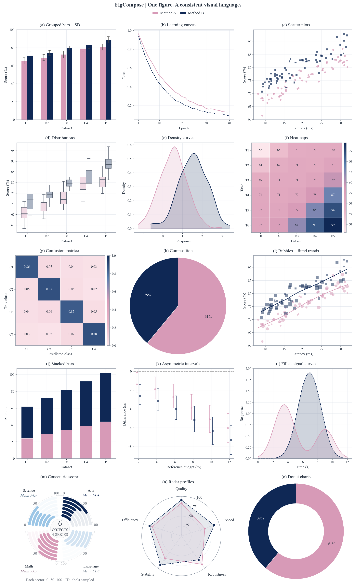
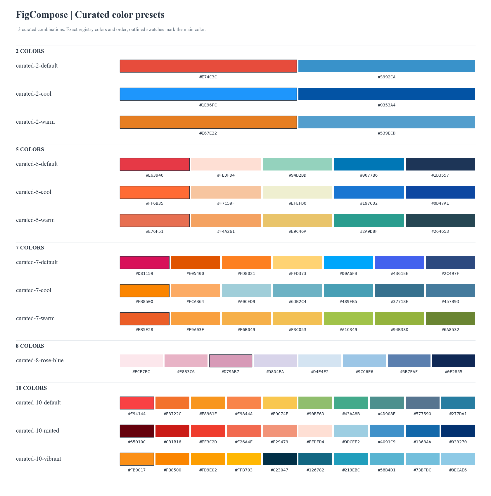
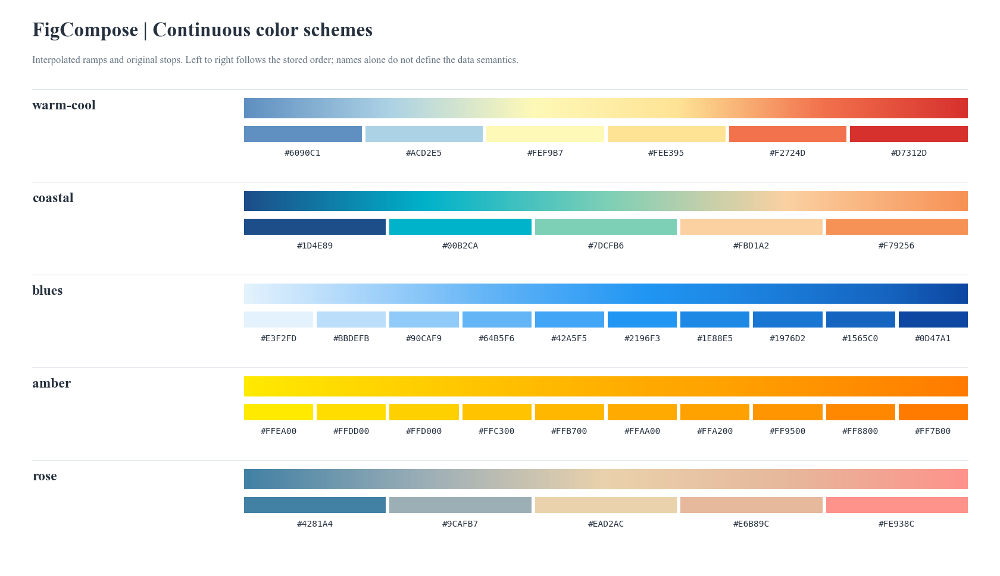

# FigCompose

<p>
  
</p>

[English](https://github.com/frederickc8896-Fabulous/FigCompose/blob/main/README.md) | **简体中文**

[](https://pypi.org/project/FigCompose/)
[](https://pypi.org/project/FigCompose/)
[](https://github.com/frederickc8896-Fabulous/FigCompose/blob/main/LICENSE)

**选好数据和图种，把论文 Figure 的排版交给 FigCompose。**



**11 种内置图表，15 个子图，一套统一配置。** 使用 FigCompose 0.1.2 直接生成，数据为模拟数据。
[查看 SVG](https://github.com/frederickc8896-Fabulous/FigCompose/blob/main/assets/readme/hero_gallery.svg) · [复现这张组图](https://github.com/frederickc8896-Fabulous/FigCompose/blob/main/assets/readme/hero.py)

输入 CSV 或 DataFrame，选择指标、子图类型和风格，统一整张图的字号、配色、图例与间距。
实验结果更新后，继续复用已经设定好的视觉规则，减少反复微调。

- **少调参数，少做重复工作**：自动安排常用图表与装饰间距，减少逐张设置字号、图例和留白的工作。
- **内置精选色卡**：13 套分类配色及 5 套连续色阶，包含暖色、冷色与混合风格。
- **整篇论文颜色统一**：登记系列后，跨 CSV 保持同一模型的颜色、点形和线型；缺少某个模型时，其余模型保持原有身份。
- **不同图种，统一排版**：柱图、曲线、散点、热力图等组合成一张 Figure，共用字体、配色和共享图例。
- **按论文尺寸出图**：指定 mm 或英寸宽度，自动计算高度；字号使用 pt，支持 PDF、SVG 和 PNG 导出。
- **延续 Matplotlib 的能力**：自定义结构图、极坐标图和三维图也能接入同一排版框架；出图检查帮助发现越界和刻度碰撞。

[快速开始](#快速开始) · [支持图种](#支持哪些图) · [全文复用](#整篇论文复用一份配置) · [配色色卡](#配色色卡) · [详细用法](https://github.com/frederickc8896-Fabulous/FigCompose/blob/main/REFERENCE.md)

## 安装

需要 Python 3.10+：

```bash
python -m pip install FigCompose
```

包名为 **FigCompose**，Python 导入使用 `data_visuals`。
**FigCompose 0.2.0** 已包含 **19 种原生图表**、全部 13 套精选配色及 `showcase` 展示风格。旧安装可用 `python -m pip install --upgrade FigCompose` 更新。
上方首屏组图实际展示 11 种图表；0.2.0 还支持分布、配对、弦图与三维图。
默认字体为 **Times New Roman**，由系统提供；缺少时回退其他衬线字体。

<details>
<summary>安装最新源码或更新已有安装</summary>

安装包含最新图种与配色的源码：

```bash
git clone https://github.com/frederickc8896-Fabulous/FigCompose.git
cd FigCompose
python -m pip install -e .
```

更新已有的源码安装，在仓库目录执行：

```bash
git pull --ff-only
python -m pip install -e .
```

更新 PyPI 安装：

```bash
python -m pip install --upgrade FigCompose
```

</details>

## 快速开始

下面的示例可以直接运行。使用自己的数据时，把 `data` 换成带表头的 CSV 路径，例如 `"results.csv"`，再指定对应列名。

```python
import pandas as pd
from data_visuals import plot

data = pd.DataFrame({
    "dataset": ["A", "A", "B", "B"],
    "model": ["Base", "Ours", "Base", "Ours"],
    "accuracy": [0.78, 0.86, 0.81, 0.89],
    "latency": [14.0, 10.0, 15.0, 11.0],
})

fig = plot(
    data,  # 或 "results.csv"
    x="dataset", group="model",
    plots=[
        {"kind": "bar", "metric": "accuracy", "title": "(a) Accuracy",
         "chart_opts": {"ylabel": "Accuracy (%)", "yformat": ".0%"}},
        {"kind": "line", "metric": "latency", "title": "(b) Latency",
         "chart_opts": {"ylabel": "Latency (ms)", "yformat": ".0f"}},
    ],
    canvas={"width": 180},
    style="modern", palette="curated-5-warm",
    title="Model comparison",
    legend={"scope": "shared", "ncols": 2},
)
fig.render("figure.pdf")
fig.render("figure.png", dpi=300)
```

常用时只需关注：

| 设置 | 你需要指定什么 |
|---|---|
| `data` | CSV 路径或 DataFrame |
| `x` / `group` | 横轴列与分组列，例如数据集和模型 |
| `plots` | 每项一个子图，选择图种 `kind` 和指标 `metric` |
| `canvas` | 整图宽度，默认单位 mm；省略高度时自动求高 |
| `style` / `palette` | 视觉风格与色卡，例如 `modern` / `curated-5-warm` |

需要时可用 `cols=2` 限制每行子图数。共享图例默认在主标题下方、子图上方，也可调整位置、列数和字号。
比例数据的 `.0%` 将 0–1 显示为百分比；已经是 0–100 的数据用 `{x:.0f}%`。
固定宽高时不会自动缩小字号；内容装不下会提示调整尺寸。
通过既有风格入口使用 `style="showcase"`，选择较大的展示字号；显式 `FigureConfig.font_sizes` 优先，配色色号与类别顺序保持不变。

### 用 AI 帮你写调用

把列名、数据单位和想呈现的内容告诉 AI，就能让它围绕 FigCompose 的简洁接口生成代码。例如：

> 请使用 FigCompose（`from data_visuals import plot`）读取 `results.csv`。列为 `dataset`、`model`、`accuracy`（0–1）和 `latency`（ms）。按模型分组，画准确率柱图与延迟折线图，每行两个子图。整图宽 180 mm、高度自动，使用 `modern` 风格和 `curated-5-warm` 配色，共享图例放在标题下方，导出 PDF 与 300 dpi PNG。

需要更复杂的设置时，把[接口参考](https://github.com/frederickc8896-Fabulous/FigCompose/blob/main/REFERENCE.md)一起提供给 AI。

## 可直接复现的示例

下载或克隆示例目录，安装 `FigCompose>=0.2.0` 后即可运行完整示例。每个目录包含实际 CSV、风格配置、脚本和预期成图。

| 从这里开始 | 可以复现什么 |
|---|---|
| [四图组合](https://github.com/frederickc8896-Fabulous/FigCompose/tree/main/examples/mixed_figure) | 两份 CSV，四类图表，缺席方法保持原有颜色与点形 |
| [差值与区间](https://github.com/frederickc8896-Fabulous/FigCompose/tree/main/examples/intervals) | 六种原生统计视角、显式配对估计与给定的非对称边界 |
| [同心环条](https://github.com/frederickc8896-Fabulous/FigCompose/tree/main/examples/circular_scores) | 原生环条图，40 个分数，各指标使用独立量尺 |

例如运行 `python examples/circular_scores/generate.py --out output/circular`。
[查看全部八个示例](https://github.com/frederickc8896-Fabulous/FigCompose/blob/main/examples/README.md)，另有原生二维三维对照、原生弦图，以及环形多轨、环形聚类和桑基流图的现成自定义模板。

## 支持哪些图

FigCompose 0.2.0 支持下列 19 个原生 `kind` 值。

| 图种 | `kind` | 常见用法 |
|---|---|---|
| 柱状图 | `bar` | 分组、水平柱、堆叠、百分比堆叠、误差线 |
| 折线图 | `line` | 趋势、点标记、阶梯线、面积填充 |
| 散点图 | `scatter` | 散点、气泡、预计算差值与区间 |
| 箱线图 | `box` | 分组分布、水平箱线、异常值 |
| 直方图 | `histogram` | 分布、密度曲线、累积分布 |
| 热力图 | `heatmap` | 指标矩阵与数值标注 |
| 混淆矩阵 | `confusion` | 计数、给定数量汇总、行归一化 |
| 饼图 / 环形图 | `pie` / `donut` | 类别份额 |
| 雷达图 | `radar` | 多指标轮廓比较 |
| 同心环条图 | `circular_bar` | 多对象的独立指标评分与分组均值 |
| 雨云图 / 山脊图 | `raincloud` / `ridgeline` | 原始观测、分布形状与描述性摘要 |
| 配对连线 / 配对估计 | `paired` / `estimation` | 匹配观测；给定或显式请求的不确定性区间 |
| 加权弦图 | `chord` | 无向对象对权重，两端使用同一角宽量尺 |
| 三维散点 | `scatter3d` | 实测 X/Y/Z 坐标与显式指定的投影平面 |
| 三维瀑布曲线 | `waterfall3d` | 按系列顺序排列的深度轴，基线明确声明 |
| 三维柱图 | `bar3d` | 完整类别网格与显式分项堆叠 |

有重复观测时，柱图、折线、雷达及热力图默认按对应分组取均值；饼图与环形图按类别求和，省略数值列时计数；散点图保留观测。
环条图使用独立分数量尺，表示的不是总量中的份额；重复对象/指标组合需明确指定汇总方式。
分布形状不表示置信区间。配对图需明确对象身份与两个水平的顺序；估计图需给定边界，或显式声明 `ci_method="paired_t"` 与 `confidence`。不猜测单位或百分比量尺。
更多统计口径、数据格式及自定义 Matplotlib 面板示例见[接口参考](https://github.com/frederickc8896-Fabulous/FigCompose/blob/main/REFERENCE.md)。

## 整篇论文复用一份配置

将字体、色卡、指标显示名和模型身份保存下来，后续每张图使用同一份 `paper.yaml`。
下面接着使用快速开始中的 `data`，完整数据与缺少基线的数据保持相同的模型颜色和点形：

```python
from data_visuals import FigureConfig, plot

paper = FigureConfig(
    canvas={"width": 180}, theme="modern", palette="curated-5-warm",
    font_family="Times New Roman",
    legend={"scope": "shared", "ncols": 2},
    fields={"accuracy": {"label": "Accuracy", "unit": "%", "format": ".0%"}},
    series={"model": [
        {"id": "Base", "label": "Baseline", "marker": "o", "linestyle": "--"},
        {"id": "Ours", "label": "Our method", "marker": "D", "linestyle": "-"},
    ]},
)
paper.save("paper.yaml")

for name, frame in [("all", data), ("subset", data[data.model != "Base"])]:
    plot(frame, config=paper, x="dataset", group="model",
         plots=[{"kind": "line", "metric": "accuracy"}],
         title="Model comparison").render(f"{name}.pdf")

# 后续脚本加载：paper = FigureConfig.load("paper.yaml")
```

需要检查成图时，可在快速开始的 `fig` 上运行：

```python
report = fig.check(debug="layout_check.png")
print(report.summary())
```

检查图会标出文字越界、刻度碰撞和小字号等问题，正式导出不带这些标记。检查与布局快照帮助核对版式；图种、统计口径和科学表达仍由研究者决定。

## 更多用法

[接口参考](https://github.com/frederickc8896-Fabulous/FigCompose/blob/main/REFERENCE.md)集中说明坐标轴、图例、全文配置、环条图、自定义 Matplotlib 面板和布局快照，便于进阶使用或交给 AI 查阅。
FigCompose 当前为 Alpha，接口仍在迭代。

## 许可证

FigCompose 采用 [Apache License 2.0](https://github.com/frederickc8896-Fabulous/FigCompose/blob/main/LICENSE) 许可证。

## 配色色卡

### 分类色与整图预设

FigCompose 提供 **13 套**精选配色，保留原始色号与顺序。传入完整名称即可使用，例如 `palette="curated-5-warm"`。
名称中的 2 / 5 / 7 / 8 / 10 表示类别容量，超出时选择更大的预设。色卡边框标出各组主色。

粉蓝八色 `curated-8-rose-blue` 的主色为 **`#D79AB7`**，FigCompose 0.1.2 及之后版本均已包含。



[查看 SVG 色卡](https://github.com/frederickc8896-Fabulous/FigCompose/blob/main/assets/readme/color_presets.svg) · 用 `from data_visuals import list_color_presets; print(list_color_presets())` 查询名称。

### 连续色阶

热力图与混淆矩阵默认使用预设配套色阶；可用 `chart_opts={"color_scheme": "blues"}` 等单独选择以下 **5 套**色阶。



[查看 SVG 色卡](https://github.com/frederickc8896-Fabulous/FigCompose/blob/main/assets/readme/color_schemes.svg)
