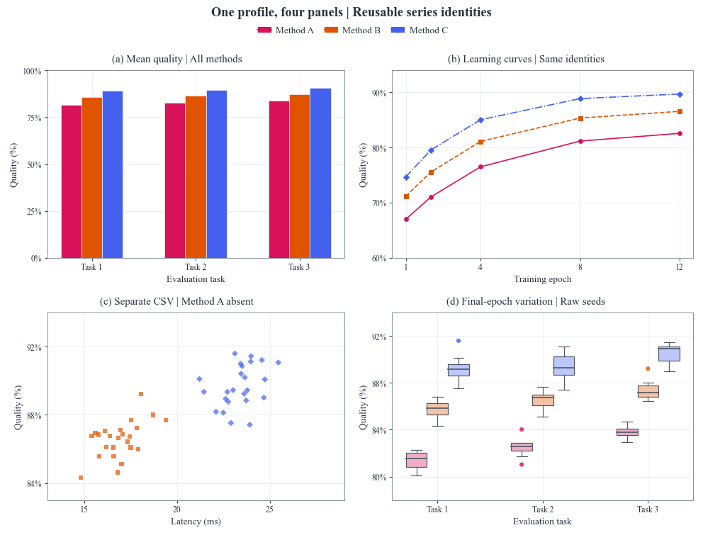
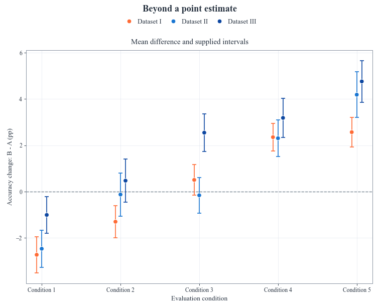
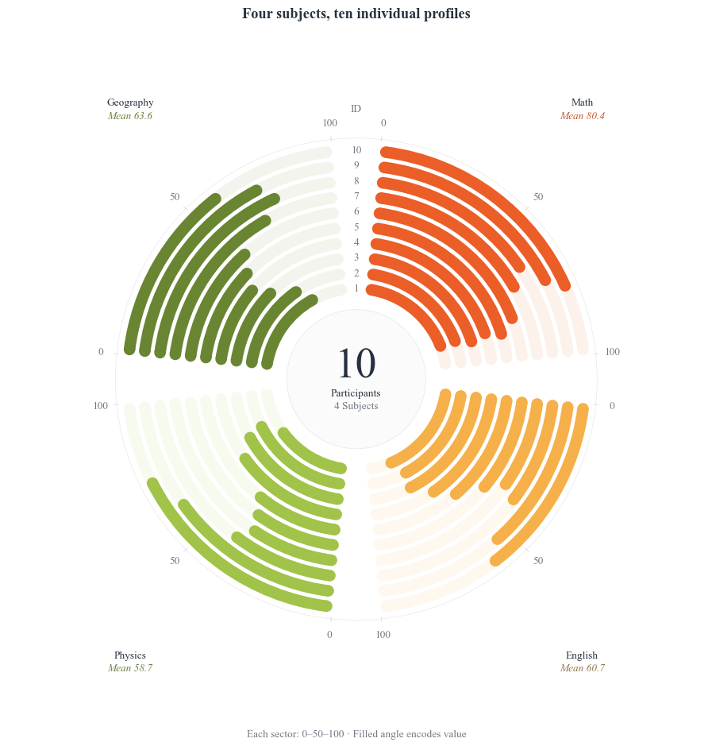
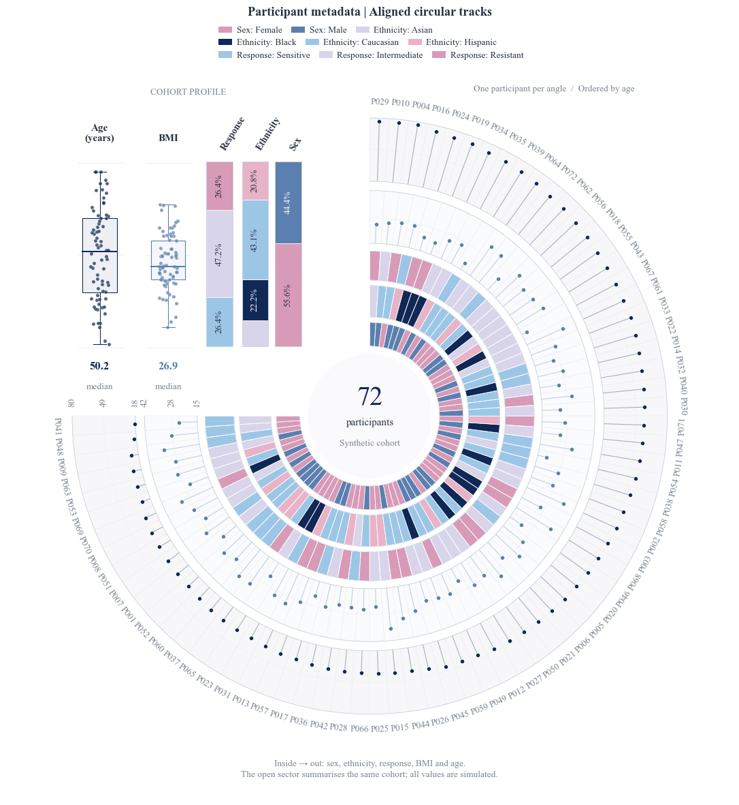
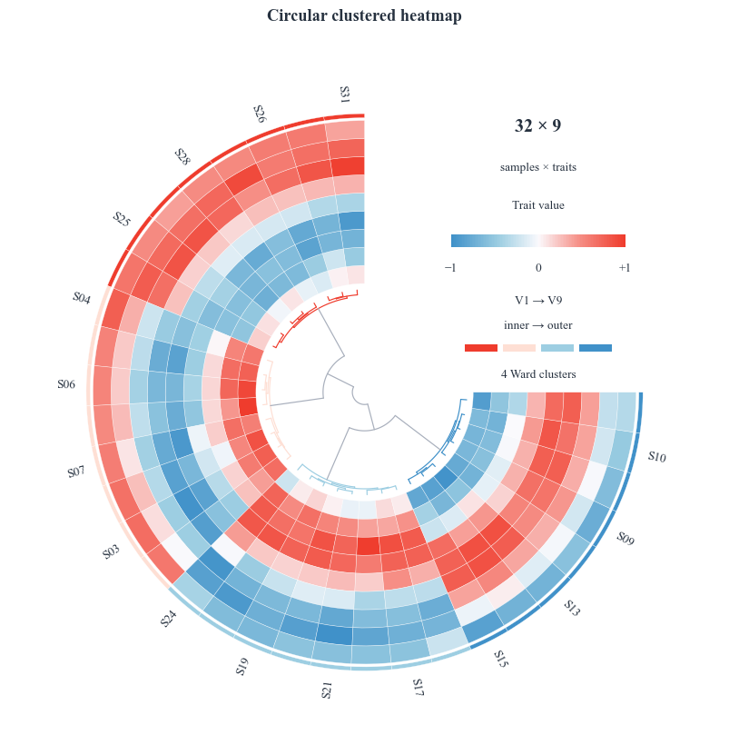
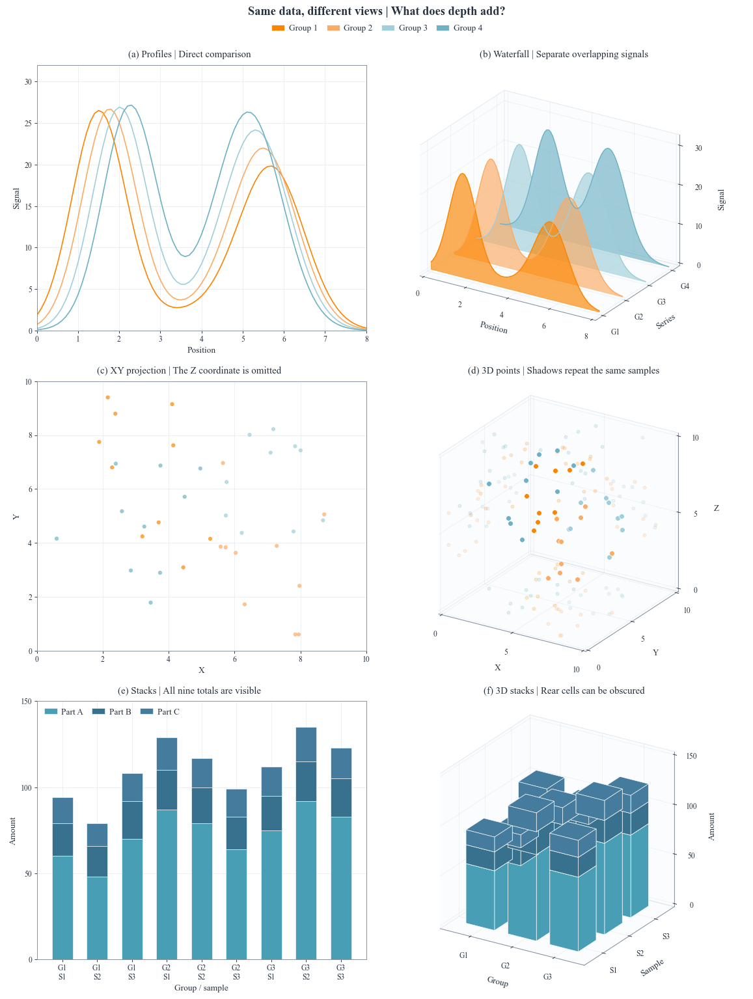
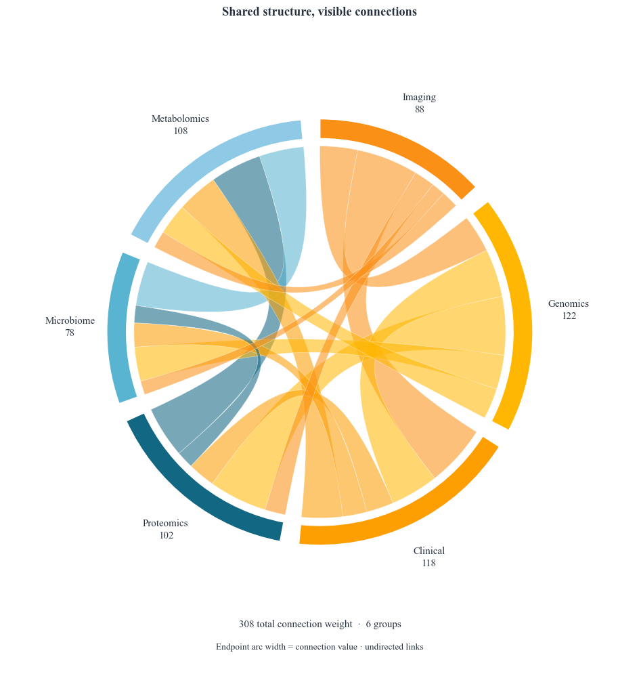
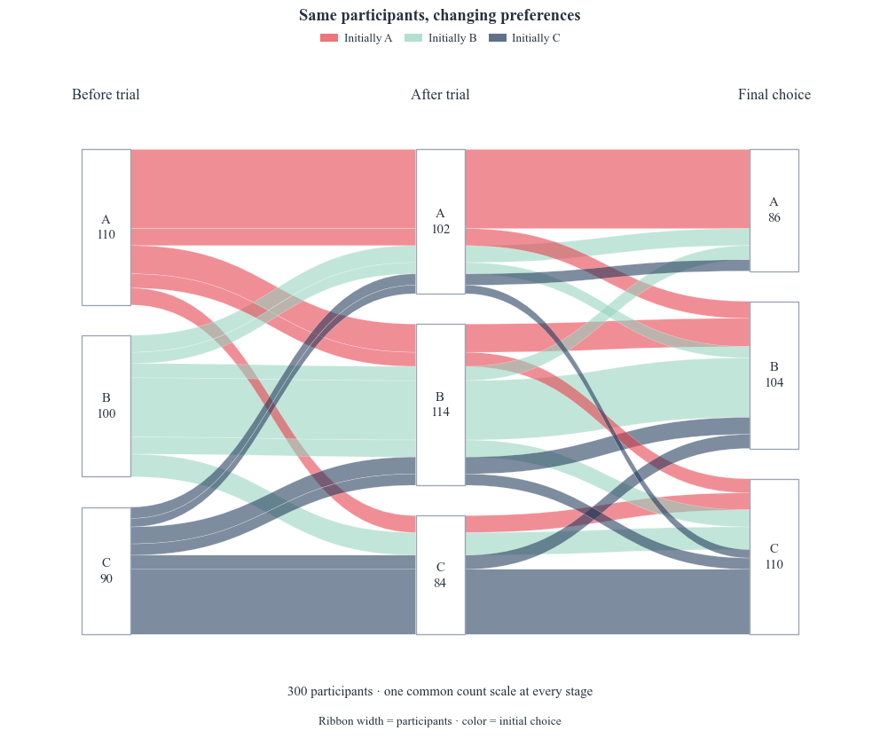

# Reproducible FigCompose examples / 可复现示例

Download or clone these folders, install **FigCompose 0.1.2+**, and run a generator.
Each example includes its actual CSV, a reusable `style.yaml`, the complete script and a preview.
The library is installed from PyPI; these example files are available in the GitHub repository.

下载或克隆这些目录，安装 **FigCompose 0.1.2+** 后运行脚本。每个示例包含实际 CSV、统一风格配置、完整代码和预期效果；无需本地 demo 或开发目录。

```bash
python -m pip install "FigCompose>=0.1.2"
python examples/mixed_figure/generate.py
python examples/intervals/generate.py
python examples/circular_scores/generate.py
```

| Example / 示例 | What it demonstrates / 展示内容 | Preview / 预览 |
|---|---|---|
| [Mixed figure / 四图组合](mixed_figure/README.md) | Four native charts; the absent method retains its identity slot / 四类原生图、缺席方法保留颜色位置 |  |
| [Intervals / 差值区间](intervals/README.md) | Stored paired estimates and supplied asymmetric bounds / 配对估计与预计算非对称区间 |  |
| [Circular scores / 同心环条](circular_scores/README.md) | Native circular scores, independent scales and group means / 原生独立分数量尺与均值 |  |
| [Participant tracks / 环形多轨](participant_tracks/README.md) | Five aligned tracks and a summary of the same cohort / 同一队列五轨对齐与总体摘要 |  |
| [Circular clustering / 环形聚类](clustered_heatmap/README.md) | Actual Ward tree, signed values and cluster annotations / 真实聚类树、数值轨与分组注释 |  |
| [2D / 3D comparison / 二维三维对照](three_dimensional_views/README.md) | Three paired views sharing their underlying values / 三组同源数据的二维三维对照 |  |
| [Chord connections / 弦图](chord_connections/README.md) | Weighted undirected relationships / 按真实权重分配弦两端与节点弧长 |  |
| [Alluvial flows / 桑基流图](alluvial_flows/README.md) | Conserved participant counts over three stages / 三阶段、同一批人的类别流向 |  |

The first three examples use built-in chart declarations. The other five include complete
`Figure.custom` templates: their drawing callbacks are supplied here, so the same template
can be reused with another CSV. They are not additional built-in `kind` values.

前三例直接使用内置图种；其余五例提供完整的 `Figure.custom` 绘制模板，可读取新的 CSV 复用。
这些模板没有额外注册为原生图种。复制示例时请一并保留公共导出文件 `examples/_export.py`。

All observations are synthetic. Default typography requests Times New Roman from the operating system;
Matplotlib falls back to another serif font if it is unavailable. Matching fonts and dependency versions
are needed for exact layout reproduction. Exports contain no manual axes placement or image assembly.

全部数据为模拟数据。默认请求系统的 Times New Roman，缺少时回退其他衬线字体；跨设备精确复现需保持字体与依赖一致。
导出由 FigCompose 管理整图布局，生成器不手动拼接图片。
