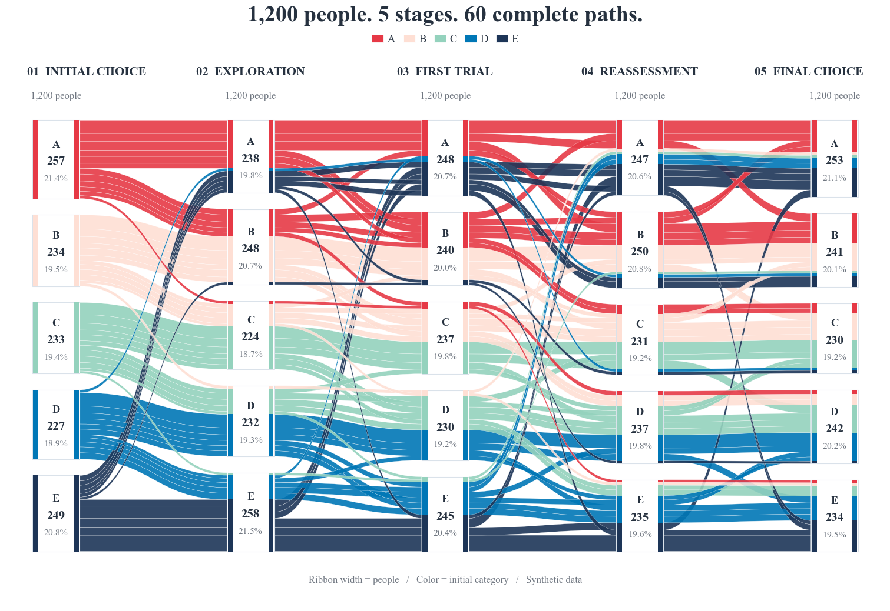

# Alluvial paths / 三阶段平行流图

This **custom Matplotlib template** is managed by FigCompose; it is not an additional native `kind`.
The same synthetic participants choose A, B or C at three snapshots. Each CSV row is a complete path.

```bash
python -m pip install "FigCompose>=0.2.0"
python examples/alluvial_flows/generate.py
```

```bash
python examples/alluvial_flows/generate.py --data paths.csv --out my_figure
```

| Column | Meaning |
|---|---|
| `entry` | Initial category |
| `decision` | Category after trial |
| `outcome` | Final category |
| `count` | Finite positive integer count of participants following that entire path |

Node heights and ribbon widths use **one common count scale** at all stages. Every path retains its weight,
and each node's incoming/outgoing path heights sum exactly to its height. Total counts are identical across stages.
Colors identify the initial choice, even when participants move to another category.
Neutral node labels show the current category, its count and its percentage of the entire cohort.
The thin colored stripe within each node retains the original path slots, showing the same initial-choice composition as the incoming and outgoing bands.
Repeated identical paths are summed; absent combinations are not invented or filled with extra participants.
The curves show observed transitions, not a causal effect or a new statistical test.

中文：这类图适合同一批对象在多个时点的类别变化。只需提供完整路径和对应人数，模板就能复用。
每阶段使用相同的宽度尺度，带子变粗表示人数更多，不能把颜色当成每个时点的当前类别。
节点中分别显示当前类别、人数及占全队列的比例；细色条按原始路径槽位显示初始类别组成，仍沿用图例的颜色含义。
所有数据均为模拟数据。

`style.yaml` reuses `modern`, Times New Roman and `curated-5-default`; the three initial choices use existing red, teal and navy swatches.
Times New Roman must be installed locally; otherwise a serif fallback is used.
The script works from another current directory and exports `figure.png` (300 dpi), `figure.svg` and `preview.png`.
Keep `examples/_export.py` when copying this example. [All examples](../README.md).


