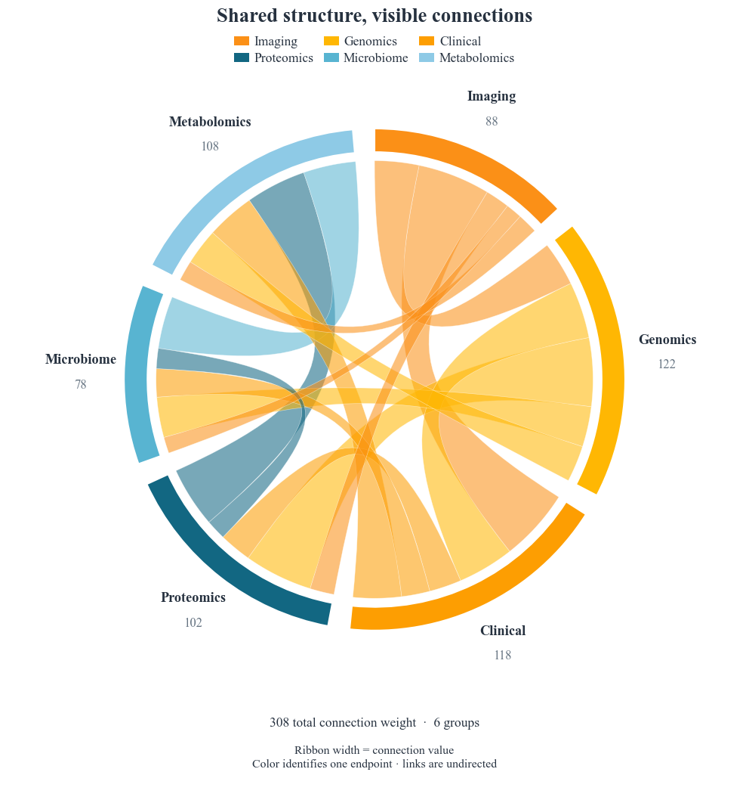

# Weighted chord diagram / 加权弦图

This ready-to-use **custom Matplotlib template** runs inside FigCompose. It is not a new native `kind`.
The synthetic example connects six research domains. Each CSV row is one undirected pair.

```bash
# From the repository root (this template uses the new typography settings):
python -m pip install .
python examples/chord_connections/generate.py
```

Use your CSV without editing geometry:

```bash
python examples/chord_connections/generate.py --data connections.csv --out my_figure
```

| Column | Meaning |
|---|---|
| `source`, `target` | Group names; each undirected pair occurs once |
| `value` | Finite positive connection weight |

The angular width of **both** ribbon endpoints is proportional to `value`, using one scale throughout.
Each group's outer arc equals the sum of its incident connections, so all group totals sum to twice the edge total.
The edge total is a sum of pair weights, not necessarily a count of unique individuals or records.
The line through a ribbon does not encode geographical distance, direction or causality.
Colors help trace one endpoint; they do not establish a flow direction.
Duplicate pairs and self-links are rejected rather than silently aggregated.
The six-group legend sits below the 16 pt title in two aligned rows of three columns.
Its 10.5 pt labels and title size are declared in `style.yaml`; group names use 11 pt,
their incident totals use 10 pt, and the reading note uses 9.5 pt.
FigCompose measures the required height at a fixed width of 210 mm. A tight custom
viewport preserves equal coordinate scales while avoiding unused space above the diagram.
The `font_sizes` configuration and aligned legend columns require the current repository
version; they have not yet been released in PyPI 0.1.2.

中文：修改 `data.csv` 中的对象对及权重即可复用。外侧弧长表示该组关联权重之和，弦两端的角宽共同表示同一权重。
这是无向关联图，不能把弦的颜色或空间位置当作因果或流向。所有数据均为模拟数据。

`style.yaml` reuses `modern`, Times New Roman and `curated-10-vibrant`. Times New Roman must be installed locally; otherwise a serif fallback is used.
The script reads paths relative to its own directory, works from another current directory, and exports `figure.png` (300 dpi), `figure.svg` and `preview.png`.
Keep `examples/_export.py` when copying this example. [All examples](../README.md).


