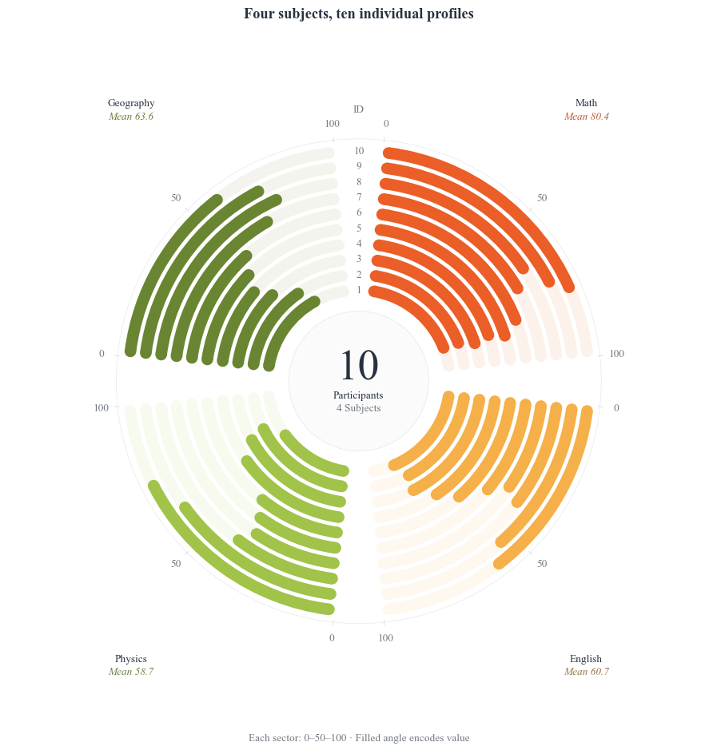

# Concentric score tracks / 同心环条评分



```bash
python -m pip install "FigCompose>=0.1.2"
python examples/circular_scores/generate.py
```

**English.** This figure uses native `kind="circular_bar"` with no drawing callback. `data.csv`
contains the 40 displayed scores: ten participants × four subjects. Every participant/subject pair
appears once. Each subject has an independent 0–100 score scale; angle represents the score, not a
share of a total. The same participant occupies the same ring in every sector. Reported means are
unweighted averages over participants. Different radii mean physical arc length is not comparable
between rings.

**中文。** 这张图直接使用原生 `circular_bar`，无需绘制回调。`data.csv` 保存十位参与者×四门学科的 40 个分数，
每个组合恰好一条记录。各扇区独立使用 0–100 量尺，角度表示分数而非总量份额；同一对象在所有扇区占同一条环。
均值按对象等权计算。不同半径的实际弧长不能直接比较。

Replace the long-form table or choose another profile / 更换长表或配置：

```bash
python examples/circular_scores/generate.py --data my_scores.csv --profile paper.yaml --out results
```

Required columns: `participant`, `subject`, `score`. Keep every participant/subject pair present.
Duplicate pairs require an explicit aggregation choice in `generate.py`; missing values are not
silently replaced with zero. `style.yaml` preserves the four original warm-palette colors.

列名为 `participant`、`subject`、`score`；各对象与指标组合需完整。重复组合需要在调用中明确选择汇总方式，
不会把缺失值静默补零。配置保留原暖色色号。

Inputs default to the script's directory; all paths can be overridden from any working directory.
Outputs: PNG (300 dpi), SVG and preview PNG (120 dpi). Times New Roman is supplied by the operating
system; a serif fallback is used if absent / 默认按脚本位置读取数据，输出正式 PNG、SVG 与预览；字体来自系统。
