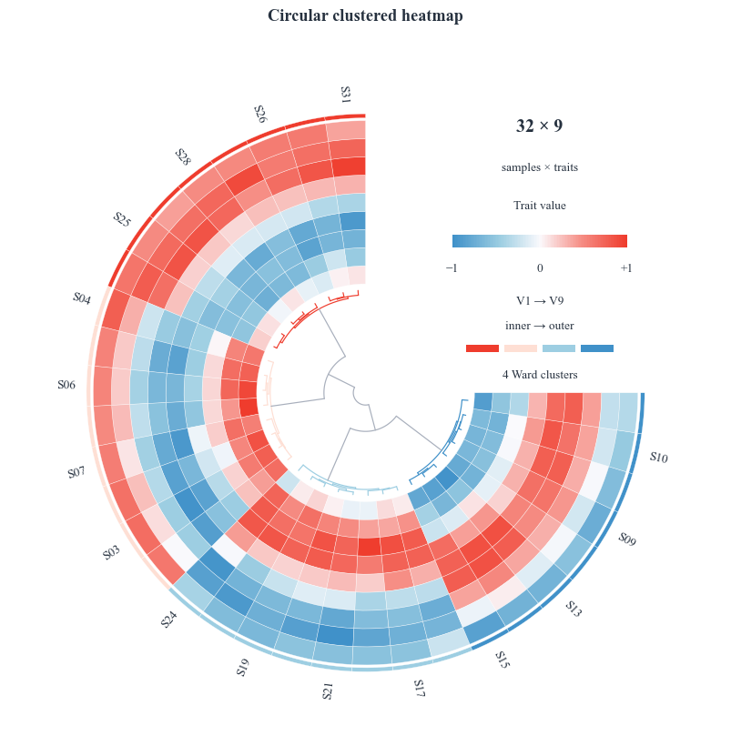

# Circular clustered heatmap / 环形聚类热图



A ready-made `Figure.custom` template: the same sample order connects a genuine
Ward dendrogram, nine signed-value tracks and a four-cluster annotation ring.
The opening explains the scale; every second sample label is shown at readable size.

```bash
python -m pip install "FigCompose>=0.2.0"
python examples/clustered_heatmap/generate.py
python examples/clustered_heatmap/generate.py --data my_matrix.csv --out output/clusters
```

Download/clone the repository first. Keep `examples/_export.py` when copying the example.
The script resolves its default inputs beside itself and works from any working directory.

`data.csv` has a first column `sample` containing unique IDs; every other column is
a numerical trait. The supplied data are 32 × 9 simulated signed scores in [-1, 1].
At least eight rows, three traits and two distinct profiles are required. Missing and nonfinite values are rejected.
The template does not silently normalise your data: use meaningful, comparable scales first.

Clustering is recomputed from the CSV using SciPy Ward linkage with Euclidean distances
and optimal leaf ordering. Merge distances are preserved radially. The thin outer track
shows four clusters cut from that same tree; it is not a tenth measured trait.

`style.yaml` reuses `curated-10-muted`; categorical cluster accents and the signed
continuous scale are derived from it. A preview, 300 dpi PNG and SVG are exported on white.
Times New Roman is requested from the system, with a serif fallback when unavailable.

中文：这是可直接换 CSV 的完整模板。沿角度读样本、沿半径读指标；中央是真实聚类树。
颜色的零点具有数据含义，不能仅为好看任意移动。相似的样本相邻并不自动构成统计结论。

[All examples](../README.md) · [FigCompose](../../README.md)
