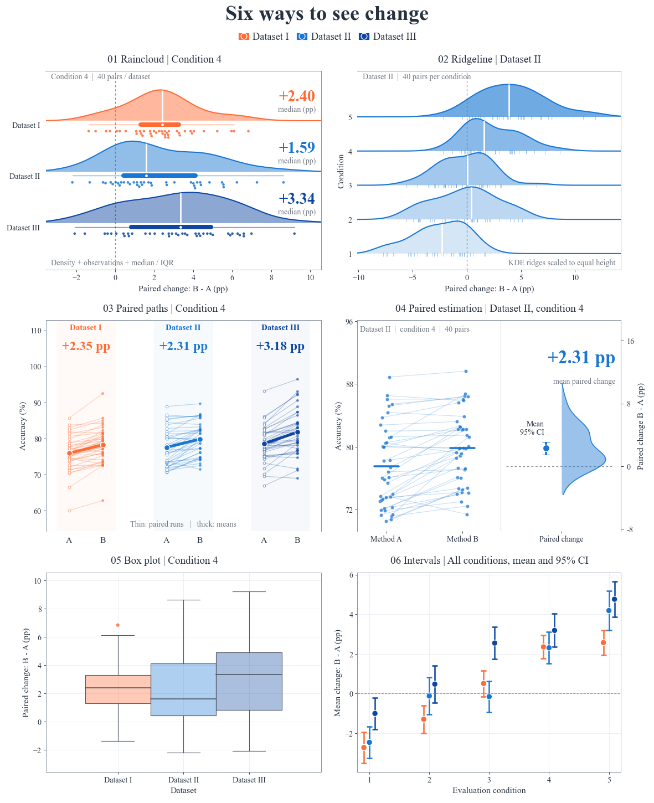
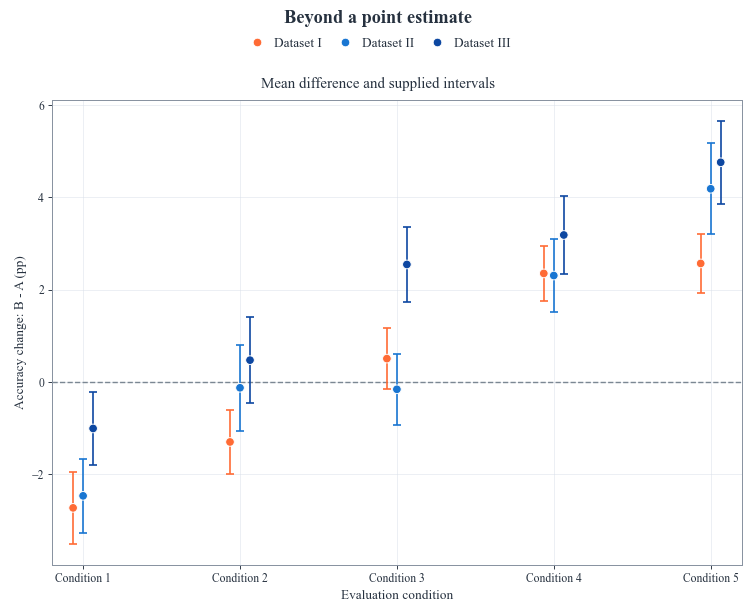

# Differences and intervals / 差值与区间

New: [six complementary views of paired data / 差异与不确定性六图系列](series/README.md).
The overview uses native raincloud, ridgeline, paired, estimation and box charts, plus
native scatter with supplied intervals. Shared data identities, statistics, fonts and the
figure legend are managed by FigCompose. There are no custom drawing callbacks.

The overview opens with full rainclouds and layered ridges, then pairs individual trajectories
with an estimation plot before ending with the two native summaries. White seams mark distribution
medians. The large raincloud numbers are medians; the paired and estimation numbers are mean B − A
changes in percentage points. They describe different summaries and are labeled separately.

新版先看饱满雨云与层叠山脊，再看个体配对和估计，最后读箱线与全部CI。白色分隔线标示中位数；
雨云的大数字是中位数，配对与估计图的大数字是均值差，单位均为百分点。所有原始点、配对线和区间完整保留。

```bash
# Native statistical charts and showcase style are included in FigCompose 0.2.0:
python -m pip install "FigCompose>=0.2.0"
python examples/intervals/generate_series.py
python examples/intervals/generate_series.py --view raincloud --condition 4 --out my_raincloud
```



The new series reads both `paired.csv` and the supplied estimates in `data.csv`.
It validates the original pairs and independently checks stored means and paired-t intervals
before drawing. No sample is generated or resampled. KDE widths describe individual differences;
they are not confidence intervals for the mean. Each panel names its data subset.

新增系列读取原始配对观测与预计算汇总：箱线、雨云和配对连线默认选条件4；山脊图选Dataset II的五条件；
配对估计图选Dataset II、条件4；区间图汇总全部15个单元。单图可独立导出，原600行数据与CI不变。

六格现已全部使用FigCompose原生声明。配对关系由`pair="paired_run"`明确指定，顺序显式为A、B；
估计图直接读取原CSV的上下界，并显式标记`confidence=.95`，不在渲染时重算区间。
原始宽表只在示例构建阶段展开成长表，未生成、删除或重新抽样任何观测。

The original supplied-bound example remains available below, including its asymmetric-bound input.



```bash
python -m pip install "FigCompose>=0.2.0"
python examples/intervals/generate.py
```

**English.** `data.csv` contains 15 precomputed estimates. Each is the mean of 40 paired B − A
differences from `paired.csv`, with a two-sided 95% paired t interval. These are synthetic observations,
not experimental claims. The generator plots supplied absolute lower/upper bounds; it does not
recompute uncertainty, symmetrize bounds or resample data. Positive values favor B; a crossing of zero
does not establish equivalence.

**中文。** `data.csv` 保存 15 个预计算估计，每个单元由 `paired.csv` 中 40 对模拟结果计算 B−A 及双侧 95% 配对 t 区间。
绘图脚本直接使用给定上下界，不重算不确定性、不强制对称，也不重新抽样。正值为 B 更高；区间跨零不等于证明两者相同。

Verify the stored statistics / 核对预计算统计量：

```bash
python examples/intervals/recompute.py
```

To demonstrate asymmetric bounds, `asymmetric_demo.csv` supplies clearly marked illustration values.
They are not computed from `paired.csv` and carry no 95% coverage claim / 非对称区间演示数据独立于配对样本，不声称具有 95% 覆盖率：

```bash
python examples/intervals/generate.py --data examples/intervals/asymmetric_demo.csv --out asymmetric_result
```

CSV fields: `dataset`, `condition`, `mean_difference_pp`, `ci95_lower_pp`, `ci95_upper_pp`.
`pp` means percentage points. For the illustration CSV, the last two names are only the API's supplied
bound columns; their origin is marked by `interval_source`. Adjust display names in `style.yaml`.

CSV 需给出数据集、条件、差值与上下界，`pp` 表示百分点。非对称演示中的上下界列沿用相同字段名以便直接换表，
`interval_source` 明确标注演示来源；展示文字可在 `style.yaml` 调整。

All generators accept `--data`, `--profile`, `--out` and work from any working directory.
Outputs: PNG (300 dpi), SVG and preview PNG (120 dpi). Times New Roman falls back to another serif
font if it is not installed / 支持自选输入、配置和输出目录；缺少 Times New Roman 时使用系统衬线回退。
