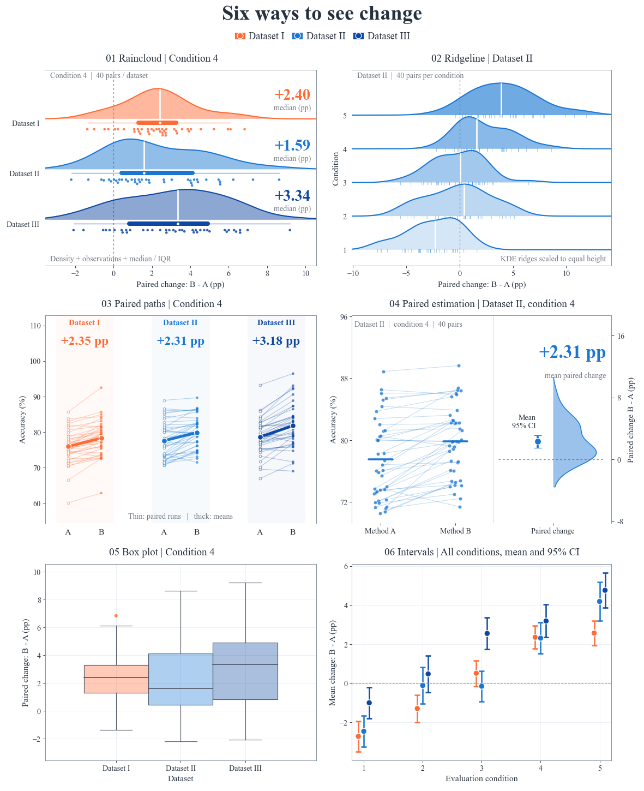

# 差异与不确定性 · 六图系列

新版以雨云与山脊开场：饱满轮廓、完整观测点和醒目的效应读数，沿分布→配对→汇总的顺序阅读。
一份模拟配对数据，六种互补视角。整图画布、标题、字体、共享图例和导出由FigCompose管理。
六格全部使用原生图种：raincloud、ridgeline、paired、estimation、box，以及带给定区间的scatter。

共有600条配对观测、15个原始汇总估计。箱线、雨云和配对连线选条件4；山脊图展示Dataset II的全部条件；配对估计选该数据集与焦点条件；区间图汇总全部条件。pp表示百分点。

[六图总览 PNG](figure.png) · [SVG](figure.svg)

| 图表 | 读法 | 独立成图 |
|---|---|---|
| Box plot: spread and outliers | 箱线图：箱体为Q1–Q3，中线为中位数；须延伸至1.5×IQR内的最远观测，须外点仍显示。它总结分布，不是均值的置信区间。 | [PNG](boxplot/figure.png) · [SVG](boxplot/figure.svg) |
| Raincloud: shape and observations | 雨云图：半小提琴按各自峰值等高缩放，比较核密度形状；中线段呈现四分位数，散点保留全部配对差值。点的纵向错位只为防重叠，不增加测量维度。 | [PNG](raincloud/figure.png) · [SVG](raincloud/figure.svg) |
| Ridgeline: conditions in context | 山脊图：选定数据集的五个条件各成一层。形状来自Scott带宽的Gaussian KDE，宽窄描述样本分布，不表示均值估计的不确定性。 | [PNG](ridgeline/figure.png) · [SVG](ridgeline/figure.svg) |
| Paired paths: individual changes | 配对连线图：每条线连接同一个paired_run的A与B原值，较粗线连接两种方法的均值。只有已知对象对应关系时才能使用配对连线。 | [PNG](paired/figure.png) · [SVG](paired/figure.svg) |
| Paired estimation: effect and precision | 配对估计图：左侧保留选定数据集的A/B原值与配对关系；右侧为个体配对差值的KDE及均值的95%配对t区间。右轴零点对齐A均值，两侧使用明确区分的量尺。 | [PNG](estimation/figure.png) · [SVG](estimation/figure.svg) |
| Intervals: uncertainty of the mean | 差值区间图：汇总全部数据集与条件的15个均值和95%配对t区间，直接使用已核对的预计算上下界。区间跨零不等于证明两者等效。 | [PNG](forest/figure.png) · [SVG](forest/figure.svg) |

源CSV保持不变：分布形状来自真实配对差值，CI来自同一批配对差值的t区间。所有数据均为模拟，不代表实验结论。
