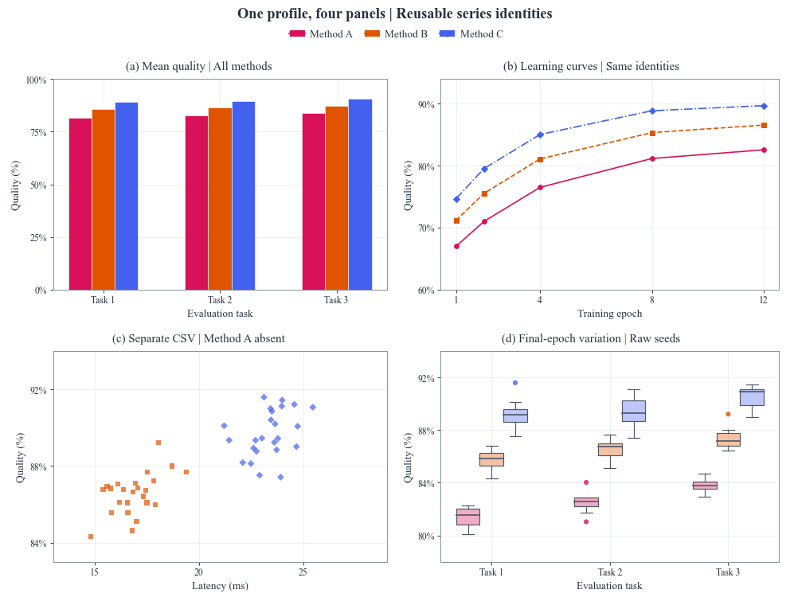

# One profile, four views / 一套配置，四种视角



```bash
python -m pip install "FigCompose>=0.3.0"
python examples/mixed_figure/generate.py
```

**English.** Four native panels share one profile and a top legend. `data.csv` contains 360 simulated
observations (three methods, three tasks, eight seeds and five epochs). `subset.csv` contains the same
observations with Method A absent. Bars and boxes use the final epoch; lines summarize observations
at each epoch; scatter uses only the separate subset CSV. Remaining methods retain their registered
colors and markers. No values or missing methods are invented by the renderer.

**中文。** 四种原生图共享一份配置与顶部图例。`data.csv` 含 360 条模拟观测（三方法×三任务×八种子×五轮），
`subset.csv` 是缺少 Method A 的同源数据。柱图与箱线取最后一轮，折线按轮汇总，散点读取独立子集 CSV。
不同文件缺少方法时，其余方法的颜色和点形保持一致。

To change inputs, edit the CSVs and `style.yaml`, or pass paths explicitly / 可直接修改 CSV 与配置，或指定路径：

```bash
python examples/mixed_figure/generate.py --data my_results.csv --subset my_subset.csv --profile paper.yaml --out results
```

Paths are resolved from the script's folder by default, so the script also works from another working directory.
Outputs: `figure.png` (300 dpi), `figure.svg`, `preview.png` (120 dpi). The SVG contains vector text and geometry.

默认按脚本所在目录找输入，从其他工作目录运行时无需改路径。输出 300 dpi PNG、SVG 与 120 dpi 预览。
