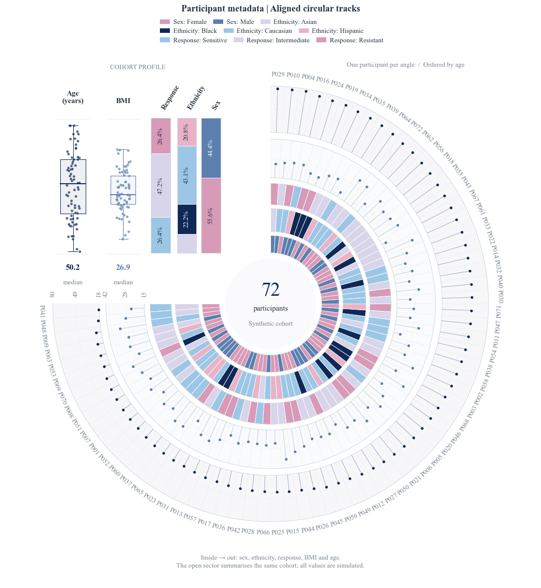

# Aligned participant tracks / 环形多轨图



One angle is one participant. The three inner tracks show sex, ethnicity and response;
the two outer tracks show BMI and age. The open sector summarises those same people.
FigCompose 0.3.0 provides the built-in `kind="participant_tracks"` and
`Figure[row, col].participant_tracks(...)`, including serializable computed data and summaries.
Install FigCompose 0.3.0 or later to run this native example.

```bash
python -m pip install "FigCompose>=0.3.0"
python examples/participant_tracks/generate.py
python examples/participant_tracks/generate.py --data my_cohort.csv --out output/cohort
```

Download/clone the repository, then run the commands above; paths to input and style
are resolved beside the script, so the generator can also be called by absolute path.
Keep `examples/_export.py` when copying this example.

`data.csv` contains 72 simulated participants. Required columns:

| Column | Meaning / accepted values |
|---|---|
| `participant` | Nonempty unique ID |
| `age` | Years, 18–80; controls the common sample order |
| `bmi` | BMI, 15–42 |
| `sex` | Female / Male |
| `ethnicity` | Asian / Black / Caucasian / Hispanic |
| `response` | Sensitive / Intermediate / Resistant |

`style.yaml` uses the existing rose-blue swatches. Export is white-background PNG,
SVG and a smaller preview. Times New Roman is used when installed; otherwise a serif
fallback is reported. The CSV values and category labels remain unchanged.

中文：每个角度对应同一个人，所有轨道按年龄排序；开口区是同一队列的总体摘要。
替换 CSV 即可使用标准图种。连续量尺和分类取值见上表。

For other cohorts, map `id` to a unique participant ID, `categorical` to 1–3 columns,
and `numeric` to 1–2 numerical columns. Give every numerical column an explicit
`numeric_ranges={column: [low, high]}`; values outside that range raise an error.
`order_by` selects one numerical column; ties use the participant ID. Optional
`category_orders`, `track_labels`, and `numeric_ticks` control category order, headings,
and printed scale ticks. Summary boxes contain the minimum, quartiles, median and maximum;
the points preserve every observed value. The short `group` name identifies the combined
category color domain and can be reused with `FigureConfig.series` and `category_colors`.

[All examples](../README.md) · [FigCompose](../../README.md)
