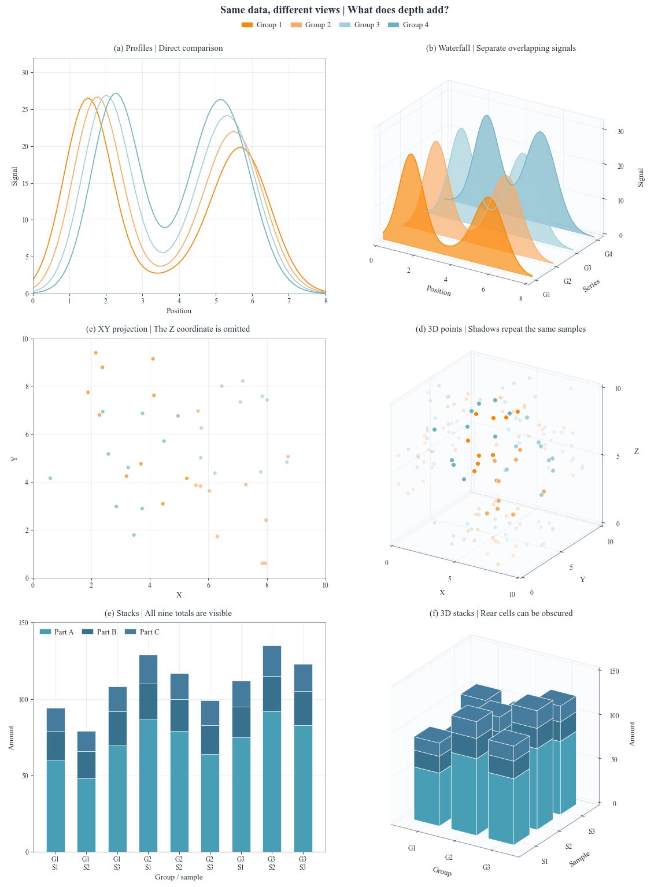

# Three paired views / 二维与三维，放在一起看



Three pairs combine the earlier waterfall, projection-scatter and stacked-bar
introductions into one comparison. Each pair reads the same rows of `data.csv`:

- Profiles: overlay the four continuous signals, then separate them in depth.
- Points: compare their XY projection with three coordinates and wall projections.
- Stacks: flatten nine stacks, then arrange their exact values on a 3 × 3 grid.

```bash
python -m pip install "FigCompose>=0.1.2"
python examples/three_dimensional_views/generate.py
```

The native 2D panels and Matplotlib `Figure.custom` 3D panels share one FigCompose
canvas, fonts and preset colors. No axes are added or positioned by hand.
Copy `examples/_export.py` along with the example; default files are resolved beside
the script, so an absolute script path works from another directory.

The 391 rows are simulated: `view=profile` uses series/x/signal, `view=points`
uses series/x/y/z, and `view=stacks` uses component/group_id/sample/amount/stack.
`style.yaml` fixes series identities using `curated-7-cool`.

The template intentionally fixes common domains for each pair: profiles X 0–8,
signal 0–32; point coordinates 0–10; stack amounts 0–150. It rejects out-of-domain
values rather than silently clipping them. The provided three stack parts must be
present at every grid position.
Stack labels must map one-to-one to group/sample positions. Each of the four
profiles needs exactly one observation per supplied series/position pair.

The 3D stack template submits all 27 cuboids in one `bar3d` call so Matplotlib can
sort their faces together. Splitting the three components into separate collections
can produce incorrect cross-layer occlusion even when the heights are correct.

中文：三维不是额外的数据。瀑布图的纵深只表示系列顺序，墙上的“影子”仍是同一批点，
三维柱图还可能遮住后排。每对图共用原始数值，帮助根据问题选择表达方式。
导出PNG、SVG和预览；三维深度排序与内部遮挡仍需要人工检查。

[All examples](../README.md) · [FigCompose](../../README.md)
